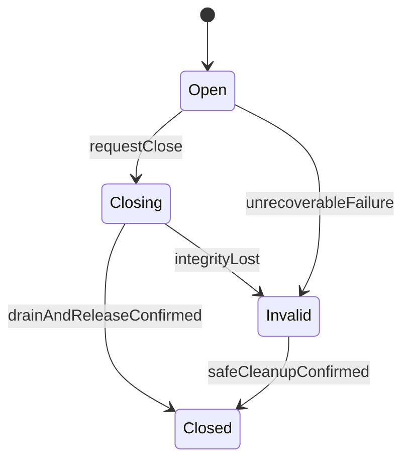

# MadB 生命周期与并发协议

引用存活、允许操作和关闭完成是三个不同事实。单一所有权表示关闭决策及最终释放责任明确，同时允许受控的共享引用和观察者。

## 资源协议

每个资源记录 owner、引用方式、依赖、操作准入和释放器。默认关闭流程：原子停止新调用准入，停止相关工作与生产者，等待已获准操作和回调退出，释放资源，公布关闭完成。

等待超时只结束等待，资源仍可能处于 Closing。无法确认安全清理时保留受管隔离状态与诊断，不能伪造 Closed 或强行释放在用内存。重复关闭请求幂等地引用同一次关闭过程。

Swift 等待超时或 Task 取消后，仍被底层使用的输入、context 和未交接资源继续由已登记 owner 保活并收尾；等待者退出不能解除该责任。停止请求、排水确认与资源释放使用同一既有关闭协议。

准入许可与关闭状态在同一同步协议下取得。一次 `if (!closed)` 检查不能保护随后操作。许可在所有成功、失败和取消路径归还；句柄可复用时采用代次或不可复用身份，防止旧句柄指向新对象。

按协议分别跟踪调用准入、原生在途工作、回调执行和结果交付。一次函数返回或对端响应不能自动清零原生工作计数。排水条件写明等待哪些责任完成，防止因提前归零而释放仍被使用的资源。

## 操作与结果交接

操作分别记录请求状态、原生工作状态、结果交付状态。先登记操作及 context，再启动可能同步完成的后端。终态采用一次认领协议，结果由消费端或清理端唯一接管。

计算结果、转换结果与通知终态分开处理。成功通知本身抛出异常时，不得再次调用失败终态通知；错误接收器也不能造成第二次完成或释放。生成器必须保留这一不变量，修复后端模板时同时覆盖“成功通知后抛异常”和“失败通知抛异常”路径。UniFFI/Gobley 的具体版本修复要求见[技术栈选型](16-technology-stack-and-versions.md)，后端版本匹配不能代替状态机验证。

| 时序 | 必须的处理 |
|---|---|
| 启动过程中同步完成 | 预先登记的上下文可接收结果 |
| 原生完成与调用方取消并发 | 由统一认领规则决定交付或回收 |
| continuation 已恢复但调用方未运行就取消 | 仍执行受管的结果清理协议 |
| 重复回调 | 识别重复通知，不重复完成；区分同一资源重复通知与新资源转移 |
| 等待者消失 | 操作 owner 继续负责停止或后台收尾 |

取消粒度分为 wait、observe、work。副作用撤销是领域协议，必须通过明确业务接口提供。`cancel()`、超时或 Future drop 不被通用解释为“没有发生任何业务效果”。

Swift `Task.cancel()` 按声明接入上述粒度；只有后端支持并已接线的 work 取消才能请求原生停止，取消等待本身不证明底层停止。取消处理可能早于原生句柄登记，也可能与完成通知并发；适配器在同一协议内处理登记与取消，continuation 在每条路径恰好恢复一次。已经认领并交出的终态不因迟到取消被改写，尚未交接的资源按下文的唯一接管协议清理。

## 订阅停止协议

订阅标识绑定到一次注册。requestStop 停止新投递准入，取消注册或切断源，处理排队数据，等待已进入用户回调的调用退出，再完成 awaitStopped。停止完成后该订阅不再调用消费者。

回调中允许发起 requestStop，但不能同步等待自己的回调退出。语言包装提供非阻塞请求，异步完成排水。注册失败、同步首回调、重复退订、源关闭和环境退出共享同一清理责任模型。

原生后端无法注销或等待停止时，必须明确能力限制。仅门控用户投递的适配器可提供较弱的“停止观察”语义，但仍要保活底层 context 至原生回调安全退出；不能冒充停止原生工作或提前释放。

状态允许按声明合并；事件声明顺序域、容量、回放和溢出方式。有限队列不自动给生产者施加背压。关键事件需要 ack/持久化时，由业务协议承担，工具可生成其传输而不虚构 exactly-once。

## 执行位置

| 约束 | 含义 |
|---|---|
| caller | 在调用线程执行，阻塞性必须公开 |
| serial executor | 操作互不并发，不保证同一 OS 线程 |
| dedicated thread | 指定线程处理调用和必要的析构 |
| UI actor/executor | 通过目标平台的 UI 入口处理 |
| runtime environment | JNI/ArkTS 等运行环境专属引用和入口规则 |

固定线程、串行性和 Swift actor 隔离分别建模；actor 不保证固定 OS 线程，跨 `await` 的步骤不能默认视为不可重入的原子操作。Rust Send/Sync、Swift Sendable 或 C++ const 都不能靠外观推导。共享状态的同步规则覆盖所有语言入口。默认避免持有内部锁调用外部代码，以两阶段读写处理重入。

Swift 按接口选择 actor 隔离、锁或已证明的 native 同步能力，UI 更新进入 MainActor；需要固定 OS 线程的调用和析构由独立的线程执行器能力承担。`Sendable` 是公开的可传递性承诺；`@unchecked Sendable` 仅限已有完整同步依据的受审计包装，不能批量用于外部对象或消除生成代码警告。具体编译器、语言模式与默认隔离设置随[配置锁定](16-technology-stack-and-versions.md)，本协议不另定最低版本或统一默认隔离值。

## 内存与环境退出

引用计数与 GC 封装只管理其负责的寿命。跨语言强引用环需要显式断开，父子依赖需要正确释放顺序。异步关闭不依赖 GC、deinit 或 Drop 恰好及时发生。

ArkTS env/Worker 退出时先拒绝新任务，再终止生产、注销/中止投递和清理引用；不能在 env 无效后调用其 API。JVM 原生线程的附着与解除、局部引用和全局引用使用独立协议。动态库保持装载直到所有可能执行其中回调和析构的对象退出。

ArkUI 页面只拥有其观察作用域；生命周期钩子不能等待时发起非阻塞停止，由明确 owner 保活并完成异步排水。页面状态适配不关闭共享业务引擎，也不把 Promise 已完成、Worker Future 已返回或终结器已运行视为 env 清理完成。ArkTS 的 Runtime、Engine、Operation/Subscription 层级沿用 [ADR-0013](../adr/0013-arkts-runtime-and-completion.md)，UI 接线见[运行时规范](08-runtime-and-idiomatic-api.md)。

## 验收不变量

1. Closed 之后无新准入，关闭之前已获准操作不会使用已释放资源。
2. 一个转移资源最终被恰好一个责任方接管或释放。
3. awaitStopped 成功之后无消费者回调。
4. 等待取消不破坏仍存活工作的输入和 context。
5. 锁、环境和析构线程符合声明，回调重入不会自等待。

测试采用 barrier 控制交错，并覆盖释放计数与后端行为；压力测试补充概率探索，不能代替确定性时序测试。

## 排水必须覆盖投递队列

原生回调返回后，排入 UI actor、协程 dispatcher 或 env 队列的闭包仍可能持有载荷和 context。只计数正在执行的原生回调，会漏掉这一段。

| 责任阶段 | 保活与停止规则 |
|---|---|
| 源端已取得 callback/context | 源端必须持有登记租约，或保证注销确认覆盖已取走但尚未进入的回调；入口内才加计数不能补救已释放的 context |
| 已入队、尚未进入用户代码 | 投递票据保有载荷；执行时在同一同步协议中检查订阅代次并认领投递许可，不能先读布尔值再调用 |
| 已进入用户回调 | requestStop 可以发生；awaitStopped 必须等待该回调退出，不能在同一回调内同步自等待 |
| 已停止的迟到投递 | 只在合法执行环境回收载荷并归还票据；不得再调用消费者 |

停止确认以“未来无法再进入消费者”为条件。不能撤回的队列项可以保留，但须已被门控且由独立收尾 owner 持有；如果关闭契约还承诺释放全部本地资源，必须继续等待其清理完成。注册失败或投递失败也归还对应责任。底层既无注销屏障、也无安全登记租约时，拒绝生成可回收 context 的强停止配置；不能仅加一个 atomic 标志。

## 完成与消费分成两个交接点

终态认领确保完成通知最多一次；结果交接还要处理“已 resume，调用方尚未拿到资源即取消”。两者不可合成一个 delivered 布尔量。结果处于 producer-owned → pending-delivery → consumer-owned 或 cleanup-owned；交接失败由唯一清理方处理，已转给消费者的对象不能再由取消处理器释放。

Kotlin 的及时取消可能发生在 resume 之后，适配器按锁定协程 API 配置未交付资源的取消回收；此机制不意味着 native 工作已停止。[协程资源交接](https://kotlinlang.org/api/kotlinx.coroutines/kotlinx-coroutines-core/kotlinx.coroutines/suspend-cancellable-coroutine.html)

上述协议的可控时序、计数与失败预期见[关键场景](../validation/08-critical-scenarios.md)。

## 首链句柄与关闭 ABI 的实施决定

DEC-03 的首链自有 Rust/C fixture 使用 `uint64_t` 登记令牌，0 为无效值；令牌在所属 SDK 实例存活期间单调分配且不复用，耗尽返回错误。查表、类型校验和操作许可获取使用同一同步协议，原生指针只保存在受管记录内。此选择仅用于 MadB 控制的首链接口；接入已有 C ABI 时保留原接口，并在包装内实现相应登记，不能擅改第三方 ABI。

包装同时保存来源 SDK/实例身份，禁止把一个后端的句柄强制转成另一个后端句柄。裸 C 调用方仍须遵守来源和参数契约；令牌不是安全认证凭证，也不承诺识别外部绕过包装的所有误用。现有 UniFFI 等后端正确提供的引用机制直接复用，不再套一个公共登记表。

| 动作 | 后条件及失败行为 |
|---|---|
| requestClose(valid handle) | 原子关闭操作准入；重复请求引用同一次关闭，不重复启动释放 |
| awaitClosed(valid handle, timeout) | 成功仅在原生工作、回调及所承诺资源清理完成后返回；超时保留 Closing |
| releaseHandle(valid handle) | 首链只允许在 Closed 后移除登记；未关闭返回 Busy；不暗中阻塞或强制销毁 |
| 重复 releaseHandle / 已移除令牌 | 返回 InvalidHandle，不再次触碰已释放对象 |
| 回调内 requestClose | 允许非阻塞请求；同回调内 awaitClosed 返回 WouldDeadlock，不等待自己 |
| Closed 后普通调用 | 有效登记返回 Closed；Closing 时返回 Closing；均不进入原生工作 |

首链状态至少区分 InvalidArgument、InvalidHandle、Closing、Closed、Busy、Timeout、WouldDeadlock、InternalFailure；C02 的[ABI 资产](../examples/first-route/README.md)固定数值、输出参数初始化及观察注册/停止规则；实际并发实现由 C05/C09 验证。领域错误使用自己的稳定 domain/code，不挤入生命周期状态。原始 `free/delete/destroy(pointer)` 仍是消费一次的接口；登记令牌的拒绝能力不能推广到已释放裸指针。

语言封装的 Drop/deinit/非挂起清理只能发起关闭或把剩余责任交给已登记的收尾 owner；需要可靠关闭确认的调用方使用显式等待接口。收尾 owner 在运行环境销毁前完成环境专属清理；无法证明这一点的配置拒绝准入，而不是声称终结器总能兜底。没有安全恢复路径的失败保留 Invalid/隔离状态，不凭超时强行释放。具体交错见 CRIT-08、CRIT-11。
