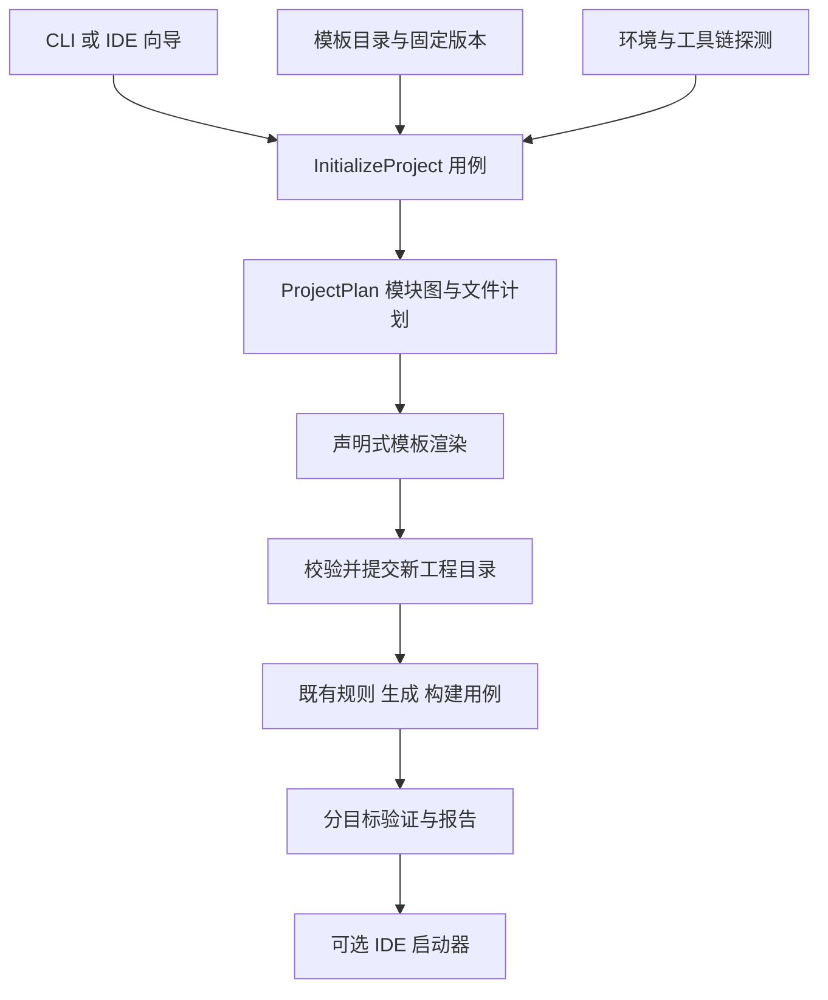

# MadB 工程初始化架构

工程初始化把受检模板转换为用户可继续开发的原生工程，并接入既有边界生成和构建链。它是应用层用例，不是新的 FFI 后端，也不改变内存、线程和取消契约。

用户体验以[产品规范](../product/04-project-initialization.md)为准；平台能力以[验收规范](../validation/06-project-initialization.md)为准。以下接口与目录是实施设计。

已确认的四项格式增量见 [ADR-0019](../adr/0019-project-init-incremental-contracts.md)：请求摘要与错误类别独立，普通成功绑定真实创建且 dry-run 单列，报告显式保存模板原输入根并复用 profile/配方的 SDK 检查，显式 profile 的默认 targets 取完整集合。剩余 envelope、原包/库存、有限 renderer、结果事实及首个 Rust/C 值接口分片已由 [ADR-0023](../adr/0023-project-template-and-init-result.md)采用；具体实现和真实执行仍分别验收，格式批准不等于 init 或 IDE 已交付。

## 1 模块和数据流



init 的 `--profile` 解析为 template profile；其中 boundary_refs 解析为确定的 boundary profiles。报告使用 template_profile 和 boundary_profiles 两个字段，避免同名 profile 混淆。

`ProjectPlan` 表达模块、文件、构建依赖、IDE 入口和检查要求；`ContractIR` 表达跨语言类型和行为。两者相互引用但不合并，避免把编辑器设置、文件目录或向导字段塞进边界语义。

| 模块 | 职责 | 输入与输出 |
|---|---|---|
| cli / 可选 IDE 向导 | 收集参数，展示计划、进度和诊断 | 同一 InitRequest → InitResult |
| app / InitializeProject | 驱动阶段、取消、输出提交与恢复 | 请求 + 明确端口 → 阶段结果 |
| template catalog adapter | 读取版本化模板与模块清单 | 模板身份 → 摘要确认的 TemplateManifest |
| 纯计划与组合校验 | 验证目标、配方、路径、依赖和文件所有权 | 清单 + 请求 + 环境观察 → ProjectPlan |
| template renderer | 对声明式资产做确定性渲染 | ProjectPlan + 输入资产 → FileSet |
| IDE integration adapter | 提供各 IDE 所需项目描述和构建接入规则 | 已知模块图 → 原生工程配置与验证要求 |
| Workspace 文件适配器 | 临时目录、无覆盖提交、文件清单和本地报告 | FileSet → 新工作区 |
| 既有 Generator / Toolchain / Verifier | 生成绑定、编译、链接和运行探针 | 已有边界配置与任务图 → 产物和证据 |
| IdeLauncher | 启动已安装的指定 IDE | 确认过的工程路径 → 启动结果 |

`ProjectComposer` 和 `TemplateRenderer` 首先作为纯函数/模块，不为每种模板创建子类。目录解析、文件系统、进程启动这些真实副作用使用小端口。IDE adapter 封装不同工程格式；不得变成同时决定业务语义、下载安装所有工具和发布应用的万能对象。

初始化的源码归属遵循[工具骨架](02-modules-and-ports.md)与[Lab 骨架](../validation/02-lab-architecture.md)，本页只列与该用例有关的映射，不另维护完整目录。

| 责任 | 源码落点 |
|---|---|
| 初始化用例 | crates/madb-app/src/use_cases/initialize/ |
| 纯工程组合与计划 | crates/madb-plan/src/project/ |
| 模板资产与 IDE 接入 | adapters/templates/、adapters/ide/；资产位于 templates/projects 和 templates/modules |
| 工作区提交与进程调用 | 注入应用端口，由 adapters/host/ 实现；复用既有 toolchains |
| 独立初始化验收 | Lab scenarios/project-init、harness/runners 的 IDE 执行配方及 expected/project-init |

目录表达职责，不要求每行成为独立 crate 或插件；原生 IDE 工程格式的差异由所选配置承担。

## 2 模板与模块配方

模板描述有独立版本，不复用扩展清单版本或 ContractIR 版本。S0 必须形成 `madb.project-template/1` schema、正反例和语义检查，作为渲染实现的前置条件。字段契约必须与模板资产一起实现和验证，说明性示例不能直接发布为模板包。

| 字段 | 含义及检查 |
|---|---|
| `schema`、`id`、`version` | 模板身份、格式和版本；包摘要保存在解析锁中 |
| `madb_compatibility` | 可读取该模板格式和任务模型的 MadB 版本范围 |
| `parameters` | 类型化名称、命名空间等输入；限制长度、字符与转义上下文 |
| `profiles` | 有限模块组合；确定运行时、调用方向、API 能力、交付形态、构建系统及配套工具链；按生成/构建/运行级别声明宿主条件 |
| `modules` | 模块身份、角色、相对目录和显式依赖；必须无环 |
| `boundary_refs` | 引用既有路线及配置；不重新定义所有权与线程语义 |
| `assets` | 模板输入、输出路径、渲染器类型和文件所有权 |
| `ide_entries` | IDE 身份、打开入口、运行目标和必要扩展 |
| `task_roots` | 可执行构建/检查根节点；引用受检任务描述，不接受任意 postCreate shell |
| `validation` | 必需结构、构建、运行、导入和调试检查及适用目标 |

文件路径必须相对工程根目录；拒绝路径穿越、越界符号链接、重复归一化路径、大小写冲突和覆盖其它模块资产。字符串按 Kotlin、XML、JSON、CMake 等实际上下文转义，不能用一次全局文本替换生成所有语言文件。

### 配置选择规则

用户通过应用/SDK、目标平台、已有接口和交付需求选择配方，工具解析底层组合。语言对相同仍可能需要不同配方；推荐目录只提供已经满足对应发布门禁的配置，实验配置需显式选择，并显示其支持范围。

| 输入场景 | 选择结果与阻断条件 |
|---|---|
| 现有 C ABI 供多个语言使用 | 保留 C ABI，调用对应生成器；不能因实现语言为 C++ 就自动切为 CXX |
| Rust/C++ 双方可修改，源码共同构建 | 可选受限 CXX 桥接配方，校验实际类型和工具链 |
| 普通 Swift SDK，消费者无需管理 C++ 构建条件 | 选择 C/ObjC++ 包装；direct interop 留给明确接受其构建要求的配置 |
| C++ 消费 Swift API | 按构建系统校验反向导出；不落入仅支持 Swift 消费 C++ 的 SwiftPM 配方 |
| 既有 UniFFI Rust 接口希望供 ArkTS 使用 | 可显式评估 UniFFI-ArkTS 实验配置；版本或类型不匹配时拒绝，不自动混用 napi 导出 |
| 同时需要官方 Kotlin 与 CPF | 独立构建根、版本目录、生成目录和发布坐标；兼容源码共享，二进制分别构建 |

运行时或必需能力不匹配时生成结构化缺口，不静默改用 JSON、删除异步方法或切换后端。完整配置选择规则复用[契约能力模型](03-contract-and-ir.md)，具体版本以[技术栈选型](16-technology-stack-and-versions.md)为准。

模块可以组合，但 profile 必须声明完整集成方式。`kmp-rust-app` 的一个示意依赖图是：

```text
Android UI ───────┐
                 ├─ Kotlin 公共 API ─ Kotlin/Rust 绑定 ─ Rust 核心
iOS SwiftUI ─────┘

ArkUI ─ Kotlin/ArkTS 适配 ─ 同一公共 API 的 OHOS 目标构建
```

上图只在 OHOS 配置确实支持该 Kotlin 公共源码和工具链时成立。平台 Kotlin fork 与标准编译器不能共用一个构建实例时，采用独立构建根并引用同一份兼容源码；二进制不跨不兼容编译器复用。源码特性不兼容则拒绝该组合，或由作者显式选择另一份公开配方，不自动复制并分叉业务实现。

业务层是否存在由模板决定；Rust 直接供 Swift 或 ArkTS 使用时，可以没有 Kotlin 层。新增语言通过模板资产、已有边界扩展和必要 IDE adapter 接入；没有新公共边界语义时不修改 ContractIR。

## 3 原生 IDE 工程适配

| 平台或模块 | 生成/接入的工程材料 | 验证重点 |
|---|---|---|
| Android 与 KMP | Gradle Wrapper、settings、模块脚本、版本目录、生成源码根、native 依赖任务 | Android Studio 导入、生成代码补全、ABI 打包、Run |
| iOS / macOS | 可直接打开的 `.xcodeproj`，必要时 `.xcworkspace`；共享 scheme、资源、签名占位、依赖构建任务 | Xcode 导入、模拟器链接运行、改源码后重建、符号匹配 |
| ArkTS / OHOS | AppScope、entry、module 描述、build-profile、oh-package、Hvigor 接入、类型声明与 native 打包 | 指定 DevEco/SDK 的 Sync、HAP 构建、设备运行 |
| Rust | Cargo workspace/crate、锁与工具链约束，按需 VS Code 工作区任务 | Cargo 分析、源码导航、构建及支持的断点 |
| C/C++ | CMakeLists、CMakePresets、编译数据库输出设置、链接和运行目标 | CLion 或 VS Code/CMake Tools 导入、配置、链接和断点 |

### Android 模块配方

AGP 9 配置中，KMP 共享库采用 `com.android.kotlin.multiplatform.library`，Android 应用使用独立模块。模板区分构建 native 与包装 native：

- Cargo/MadB 已生成的 `.so` 通过版本对应的 `jniLibs` 源接入点登记，不要求额外 CMake 构建模块；生产任务、ABI 目录、传递库和去重规则必须明确。
- 使用 `externalNativeBuild` 或需要 Android build types/flavors 时，生成独立 `com.android.library` 模块，再由 KMP androidMain 消费。
- host/device 测试显式启用，验证任务名称随插件版本解析；没有生成测试任务不能解释为用例通过。
- SDK 模板交付可独立消费的 AAR 及依赖关系；应用模板的本机 `.so` 复制方案不能代替 SDK 发布接入。

Android Studio、AGP、KGP、Gradle、JDK 与宿主条件构成完整配置。Preflight 检查 IDE 能否打开所选 AGP 工程，不能仅确认命令行存在 Java。具体候选约束由技术栈表维护。[Android KMP 插件](https://developer.android.com/kotlin/multiplatform/plugin)

### Apple 与 OHOS 的交付配置

实际文件结构随模板锁定版本确定。仅有 `Package.swift` 不能充当包含应用目标、资源和 scheme 的完整 iOS 应用工程；SDK 模板可以使用 SwiftPM，应用模板必须交付应用入口。

Swift 模板按 [ADR-0014](../adr/0014-swift-production-baseline.md)区分两个角色，使用相同的公开 SDK 契约，但不要求相同的本机工具：

| 角色 | 工程与构建接入 |
|---|---|
| SDK 作者或源码共同构建者 | 项目 Wrapper 固定 MadB 和所选 native 工具链；CLI 与 IDE 接入同一受检子任务，生成绑定、构建 native 核心，按选定配方准备产物；推荐二进制分发配方形成混合 SwiftPM 包，源码共同构建按其独立配方 |
| 预生成 SDK 消费者 | 普通 SwiftPM 依赖引用源码包装及 native XCFramework；由原生工程解析、编译和链接，不安装作者的 MadB/Cargo/Gradle/SKIE 编译插件，不手工复制库 |

依赖解析以当前顶层消费者工程的 `Package.resolved` 为解析快照；库的 `Package.swift` 声明兼容约束，依赖库自带的 `Package.resolved` 不能强制替换消费者根锁。作者构建根与 Lab 消费根各保存自己的解析结果，MadB 的构建身份记录本次实际解析输入；更新锁必须显式，frozen 构建不自动升级或回写别人的根锁。根锁不是 SDK 运行时依赖，也不是下游兼容性证明。[SwiftPM 依赖解析](https://github.com/swiftlang/swift-package-manager/blob/main/Sources/PackageManagerDocs/Documentation.docc/ResolvingPackageVersions.md)

Swift 扩展配方按 [ADR-0015](../adr/0015-swift-extension-delivery.md)显式选择，Preflight 分别检查基础产品、所选 UI/响应式产品的目标条件，以及宏/生成器的宿主工具链；产品未选用时不把该扩展的前置条件施加给普通 SDK。包级最低系统、依赖解析与实际链接隔离按[发布规范](09-build-packaging-release.md)验证，不从多个 product 名称推导隔离成功。

选择或更换 NativeCoroutines 配方时，作者构建同时更新 Kotlin 生成配置、受影响符号和 Swift 包依赖，再生成同一候选；消费者使用该候选，不自行补 Kotlin 插件。模板不同时维护两份桥接权威，也不把桥接升级隐含在一次普通 Xcode 包解析中。宏和 SwiftPM 构建插件分别登记宿主与目标输入，CLI/IDE 必须得到同一展开和生成结果。

SwiftPM、Xcode 和自定义构建对 Swift/C++ 的支持方向分别认证。二进制 SDK 模板显式接入 SKIE 分发设置和消费调用探针；源码共同构建配置不强制启用无需求的 library evolution。macOS 宿主版本与 Xcode 版本一起检查，生成 `.xcodeproj` 不能替代编译或运行条件。

OHOS 模板分别记录 HarmonyOS/OpenHarmony SDK、ArkTS 运行时、DevEco/Hvigor/ohpm 和目标 ABI。CPF 与官方 Kotlin 的 SDK 首版使用独立发布坐标，模板承担依赖映射；根 metadata、平台制品和包校验按[发布配方](09-build-packaging-release.md)执行。

ArkTS 作者工程通过一致的 CLI/IDE 入口更新声明和绑定；普通 HAR 消费工程只依赖已交付的公开包及平台工具。需要 ArkUI 时显式选择适用的状态版本与页面生命周期适配，构造和属性读取不启动订阅，页面停止观察不关闭共享业务引擎。必要配方和可选组合分别按 [ADR-0016](../adr/0016-arkts-production-baseline.md)、[ADR-0017](../adr/0017-arkts-extension-delivery.md)选择，不能由某个 Demo 的路径或构建成功推导模板已可独立交付。

Apple 工程文件生成优先评估固定版本 XcodeGen，封装在 adapter 中，S0 探针确认覆盖范围和依赖成本后采用。默认仅在初始化时生成 `.xcodeproj`，随后将工程文件交给用户在 Xcode 中维护；内部生成描述只用于来源追踪，不作为第二个可编辑权威源。绑定使用稳定的输出位置和该版本支持的源码引用方式更新，无需每次重写整个 Xcode 工程。若另设持续管理工程描述的 profile，必须显式声明不同的所有权模式并单独验收。

原生可用工程、依赖接入和共享构建入口是基础能力。XcodeGen/Tuist 等工程生成器、fastlane 发布编排及额外 lint 工具按[技术栈与工具分层](16-technology-stack-and-versions.md)选择；它们不成为 SDK 消费者的默认安装项，不重复维护同一工程的权威描述，也不替代候选提交和 Lab 验收。

KMP 与 Xcode 的接入优先复用所选版本官方 Gradle 集成任务；生成脚本负责配置它，不另造 Framework 复制和签名流程。IDE 插件可能已经提前构建 Kotlin Framework，须保留上游集成要求的重复构建防护，并验证 Xcode 直接运行和 IDE 发起运行两条路径。

## 4 从计划到可用工程

| 阶段 | 行为 | 失败结果 |
|---|---|---|
| Resolve | 按运行时、方向、API 能力、交付形态与构建系统解析 profile，固定版本和来源 | 不创建工程；列出缺失/冲突能力 |
| Preflight | 按请求级别检查输出不存在、宿主条件、所需 SDK/工具和请求的 IDE | 不创建工程；给出可执行修复步骤 |
| Render | 在同一文件系统的受管临时目录渲染源码、配置和 Wrapper | 清理自有临时内容，不碰用户目录 |
| ValidateStructure | 检查模块、路径、入口、引用、锁和结构约束 | 不提交无效工程 |
| CommitNew | 不覆盖地提交完整源码树到最终路径 | 并发竞争或目录冲突返回冲突错误 |
| PrepareAndBuild | 在最终路径解析项目依赖、生成绑定并构建请求目标 | 保留工程，标记 `created-not-ready` |
| Verify | 按本次级别执行构建或运行检查，写结果 | 返回非零及分目标诊断，不虚报就绪 |
| Open | 请求时启动指定 IDE | 保留工程与已完成证据；单独报告启动失败 |

编译器缓存和 IDE 配置可能记录绝对路径，不能在临时目录构建一次、移动后直接声称最终路径可用。源树提交与构建成功是两个状态：提交保证文件集合完整，不保证全部工具执行成功。

`structure` 不要求只在编译/运行阶段使用的 SDK，但仍要求模板渲染器在当前宿主可用；无法生成实际工程文件时返回不支持，不能生成一个空壳后宣称完成。`--dry-run` 只使用随工具提供或本地缓存的模板元数据；未知模板明确报缺项，不为模拟执行偷偷联网。

`CommitNew` 使用平台提供的无覆盖创建/提交策略，避免先检查再覆盖的竞态。取消前未提交则清理暂存；已经提交则保留工程和阶段报告。多个目标独立检查，但请求的任一必需目标失败都使整体返回非零。依赖失败的下游标为 blocked，不伪装为不适用。

除显式输出目录外，普通项目依赖和受管工具可以写入约定缓存；路径及网络行为出现在 dry-run 计划中。系统软件、协议接受、全局 IDE 设置与发布签名不由初始化修改。

## 5 IDE 中的日常构建

SDK 作者或源码共同构建者修改导出函数后，IDE 正常构建自动执行该 profile 的无环任务图：必要的 metadata 准备、读取/检查、生成、目标编译、消费链接和打包。阶段依赖以[生成与提交规范](07-code-generation.md)为准，不强制所有后端使用同一编译顺序。预生成 SDK 消费者只执行其原生包构建任务，不挂接作者的生成链。

模板 profile 还选择[语言体验组件](15-developer-ergonomics.md)：后端注解、所需 KSP/宏生成任务、普通 SDK 与可选 UI/协程包。生成依赖和应用运行依赖分别登记；预生成 SDK 消费模板不强行安装作者侧编译插件。高级宏或插桩按明确能力启用，进入同一锁和 IDE 验证。

1. Gradle/Hvigor/Xcode 接入声明真实输入输出、工具版本和任务依赖。
2. 需要 MadB 生成或 native 构建的原生任务调用项目 Wrapper，与 CLI 使用同一入口和解析配置，而非假定 GUI 进程继承终端 PATH。
3. 跨工具只调用明确的子任务。例如 `madbw build --task ios-boundary --frozen` 只构建边界依赖，不能再次构建调用它的 iOS 应用。
4. 顶层 `madbw build --frozen` 可以编排应用构建；图检查拒绝 Gradle→MadB→同一 Gradle 应用的循环。
5. 外部构建进程运行时不持有其子任务需要的全局工作区锁；任务按目标和产物身份协调，重复调用复用有效缓存。
6. 生成物作为明确源码根参与索引；首次导入所需声明在初始化准备阶段生成。需要 SDK 才能生成时，`structure` 模式明确记录索引尚未验证。

Xcode profile 必须验证生成源码集合变化时的收集方式，例如固定聚合输出文件，或所选 Xcode 版本支持的同步目录引用。不能只验证现有绑定文件编译通过，却在新增导出类型后遗漏新文件。IDE 检测到需要人为更新工程文件才能继续普通绑定开发时，该模板不能通过 INIT-04。

不得在 IDE 索引、Gradle 配置阶段或代码补全回调里隐式执行长时间原生构建。Wrapper 固定 MadB 版本、来源和校验摘要；校验后才执行下载的工具。离线只读可信缓存，缺失时提示修复。受管 MadB 工具下载不等于下载完整 Xcode 或平台 SDK。

## 6 输出所有权与工程可持续使用

| 文件类别 | 例子 | 后续策略 |
|---|---|---|
| 创建后交给用户 | 示例业务、应用资源、可编辑构建入口、工程描述 | 初始化只写一次；generate 不覆盖 |
| 持续受管生成 | FFI 绑定、声明文件、标为受管的 IDE 描述派生物 | 输入明确、确定性生成、冲突检查与事务提交 |
| 本机状态 | SDK 路径、IDE 缓存、签名引用、临时设备选择 | 放在忽略文件中，不作为共享模板内容 |
| 版本与来源 | 工具 Wrapper 属性、项目锁、模板来源及文件所有权清单 | 可提交版本控制；更新必须显式 |

应用构建脚本通过小型插件/脚本导入受管逻辑，避免反复重写用户脚本。`init` 只创建新工程；已有工程的接入、升级与禁用使用受检变更用例，复用 ProjectPlan、文件所有权、锁与事务，不再运行 init 覆盖目录。

### 已有工程的接入、升级与禁用

| 用例 | 变更前需要给出的内容 | 执行与失败边界 |
|---|---|---|
| 接入现有工程 | 已识别的原生构建入口、将新增的模块/依赖、受管位置、必要用户编辑与验证范围 | 仅支持明确配方；未知工程形态准确说明限制，不猜测并改写任意构建脚本 |
| 升级工具、SDK 或扩展 | 新旧锁、API/ABI/语义影响、模板及文件差异、证据失效范围 | 默认不重写交给用户的工程文件；冲突先定位；新结果确认前保留原锁与完整批次 |
| 禁用或更换可选项 | 下次构建的基础配置、将移除的受管依赖/输出、仍被其他模块使用的资产 | 不删除共享或用户文件；基础配置重新构建并独立消费；不承诺运行时热卸载 |

计划与执行之间再次核对基准文件及锁，发现并发改动返回冲突。多文件修改采用受管暂存、可恢复提交及明确恢复说明；不能把部分修改显示为全部成功，也不把文件回滚称作已撤销外部副作用。

I01 固定计划、所有权、诊断与恢复契约；I02–I05 随各自配方交付可用接入，I06 收口适用 INIT 验证。命令名称和新 wire 在实现前按已有格式流程定稿，本页不伪造现行字段。它们用于用户自己的新旧应用/SDK，不增加旧 mad、MadDemo 或 mad-boundary 迁移任务。

`.gitignore` 排除构建缓存、本机配置和签名材料。生成工具不默认创建远程仓库、不提交代码、不上传项目。CI 示例引用公开安装方式与模板锁，不依赖 MadB 源仓库相对路径。

## 7 结果与诊断契约

`InitResult` 至少包含请求摘要、模板及配置版本、最终路径、创建状态、分目标检查结果、IDE 入口、启动结果、恢复步骤和日志路径。每条检查用 `passed / failed / error / skipped / unsupported / blocked`，并附前提、环境、实际执行命令摘要和证据位置。

进程成功码只表示请求级别全部完成。例如 `--verify structure` 成功不会填入 build/run/import/debug 的通过结果。IDE 模板认证引用与本机实测分开保存。`--open` 请求失败返回非零，但不撤销已创建工程；报告区分 created、verification 和 open 三部分，避免用户误删成功产物。

诊断复用既有格式，新增 INIT 分类覆盖：输出冲突、配置不兼容、必需环境缺失、模板资产错误、构建失败、IDE 打开失败与离线缺包。报告默认去除凭证和用户敏感路径；本机恢复信息需要完整路径时存本地并提供脱敏导出。

## 8 扩展和设计原则

模板、SDK 增强和工具链的选择、冲突检查及实施决定统一遵循[扩展组合契约](17-extension-composition.md)。模板只引用已声明组件与资产。

现有边界扩展可以复用 `assets.kind=template` 携带模板，纯模板包则由独立模板目录分发，不虚构组件或路线。声明式工程模板由宿主校验和渲染；现有语言端口继续生成边界代码，不给模板增加任意 shell 执行权限。需要新的过程式工程生成能力时，先通过[协议演进](13-contract-evolution.md)评审和协商，不能塞进扩展元数据偷偷执行。

单一职责使模板组合、工程文件生成、环境探测、构建和 IDE 启动分别变化；依赖倒置让核心面向值与端口；Adapter 隔离 IDE；组合优于继承表达模板；任务图处理顺序；状态机区分生成与就绪；文件所有权规则保护用户代码。无需增加应用运行时组件。

## 9 机制依据

- Kotlin 官方列出 KMP 的 IDE 与 Xcode 前提，支持本方案按实际工具组合验证：[IDE 建议](https://kotlinlang.org/docs/multiplatform/recommended-ides.html)。
- KMP 提供 Gradle 与 Xcode 的直接集成及避免重复构建的防护；脚本细节跟随固定版本：[直接集成](https://kotlinlang.org/docs/multiplatform/multiplatform-direct-integration.html)。
- Gradle Wrapper 固定构建发行版，适合作为原生工程入口：[Wrapper](https://docs.gradle.org/current/userguide/gradle_wrapper.html)。
- XcodeGen 从声明式描述生成 Xcode 工程，是本设计的工程文件生成候选：[项目文档](https://github.com/yonaskolb/XcodeGen)。
- OpenHarmony 生态工程包含 Hvigor、oh-package、模块配置等，须按实际 SDK 模板验证：[Oniro 工程结构](https://docs.oniroproject.org/application-development/create-your-first-app/project-structure/)。
- CMake Presets 记录配置、构建与测试预设；VS Code Tasks 接入工具执行，均不能单独证明调试可用：[CMake](https://cmake.org/cmake/help/latest/manual/cmake-presets.7.html)、[VS Code](https://code.visualstudio.com/docs/debugtest/tasks)。

以上资料说明机制可复用，不证明 MadB 模板已通过对应环境测试。版本号由探针、锁和 Lab 证据确定，不追随网页 latest 自动更新。

## 并发构建与更新边界

IDE 和 CLI 使用同一个输出域、输入追踪和批次租约协议；单次构建固定生成批次，不能分别跟随头文件、包装与库的 latest。模板把间接头文件、生成源码集合、编译宏和环境输入接入原生构建系统，按 CRIT-09/10 及 INIT-04 验证修改后的自动重建。

Swift 配方的增量输入还包含实际源文件及文件集合变化、Package.swift 和当前构建根的解析锁、生成器/模板/补丁、native 公开头与 module map、资源、目标/SDK/工具链、语言与互操作开关、编译链接参数及白名单环境。依赖发现和缓存准入复用[输入追踪规则](07-code-generation.md#输入追踪与确定性缓存)；只按时间戳、单一导出文件或 Package.resolved 判断命中不足以证明输入完整。不能可靠枚举时保守重建或禁用对应缓存，不因 GUI 构建成功另设宽松路径。

工程变更沿第 6 节的接入、升级与禁用流程执行；与构建共享基准复核和输出协调，避免更新工程配置时另一构建读取混合版本。

## 只读doctor具体契约

[ADR-0025](../adr/0025-doctor-preflight-contract.md)采用现有冻结工程上下文的doctor入口及`doctor-result/1`。structure/build/run只选择静态前提集合；完整配置、声明输入和IR先按现有规则核验，随后按受信有限配方观察工具、SDK和资源。成功不代表执行构建或运行，部分事实不授予执行凭据。机器输出、错误汇总、重验和预算规则以批准提案为准；模板选择模式与整包出口仍另行交付。
