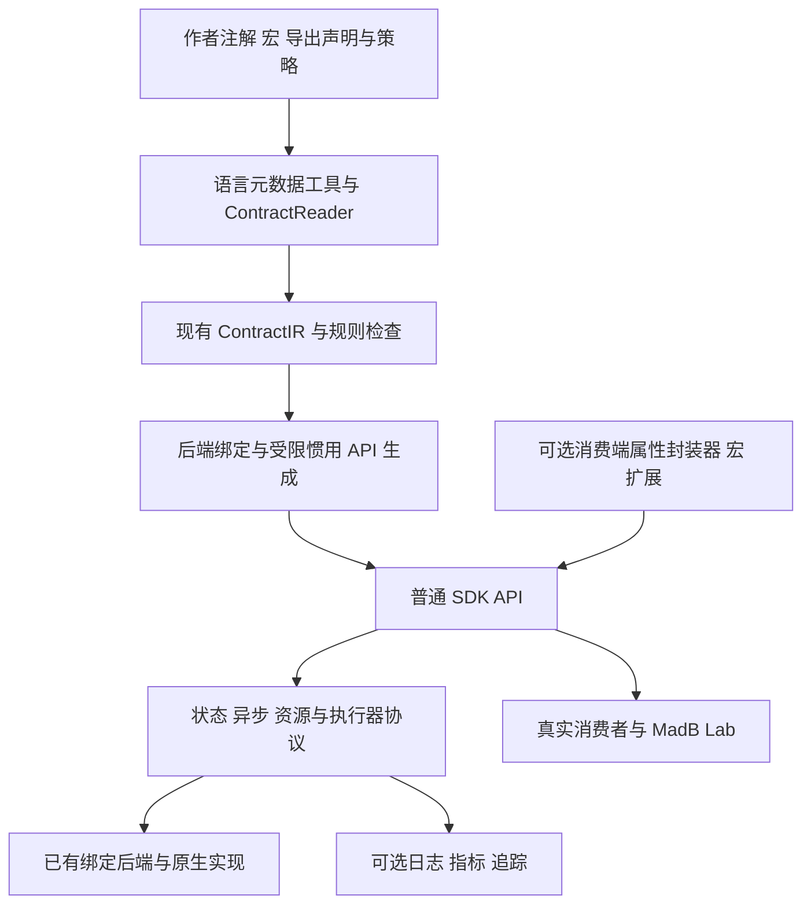

# MadB 语言特性与低门槛 API 设计

MadB 通过三条路径降低使用门槛：用注解和宏减少 SDK 作者的重复代码，用语言惯用 API 简化业务调用，用自动诊断降低排错成本。便利语法依赖受检契约和可靠运行时，不能代替资源所有权、线程安全与取消效果的设计。

本规范覆盖 Kotlin、Swift、ArkTS、Rust、C、C++，并保留 Dart 扩展探针。模块职责和示例 API 不代表全部已实现；每种便利能力按实际后端配置交付。实施任务见[交付计划](../delivery/01-implementation-plan.md)，验证见[开发体验验收](../validation/07-developer-ergonomics.md)。

Swift 的必要能力、后端选择与公开交付决定见 [ADR-0014](../adr/0014-swift-production-baseline.md)，九项扩展选择与实施交接见 [ADR-0015](../adr/0015-swift-extension-delivery.md)。本文维护普通 API、声明生成和便利层的具体职责；运行协议、构建和发布条件继续由各自规范维护。

ArkTS 的十二项必要能力与十二项扩展的选择、替代方案和任务映射分别集中在 [ADR-0016](../adr/0016-arkts-production-baseline.md)、[ADR-0017](../adr/0017-arkts-extension-delivery.md)。本文只维护普通 API、页面状态与语言便利层的职责，不重复建立能力或实施状态清单。

## 1 三类用户需求

| 路径 | 使用者希望做什么 | MadB 承担什么 | 必须明确什么 |
|---|---|---|---|
| 声明式导出 | 标记公开接口，少写转换和构建接线 | 读取声明、补全可推导信息、检查契约、生成绑定 | 作者仍决定释放器、线程、取消及业务成功的含义 |
| 惯用 API | 使用普通方法、属性、await 和状态流 | 适配异步、资源、状态及生命周期 | 消费者仍理解方法效果和自己拥有的资源 |
| 自动诊断 | 快速定位编译错误、泄漏、卡顿和错库 | 来源映射、诊断钩子、指标、符号关联 | 诊断覆盖和目标限制不能被隐藏 |

注解和宏属于入口机制，不是新的业务契约语言。已有 UniFFI 等后端声明能够表达的内容直接复用；缺少的语义按[契约权威源](03-contract-and-ir.md)规则补充，不要求再写一套重复注解。

## 2 各语言的选型

| 语言 | 可利用特性与工具 | MadB 用途 | 约束与选型依据 |
|---|---|---|---|
| Kotlin | 注解、KSP、属性委托、扩展函数、suspend、Flow | 读取导出声明；生成受限 Facade、类型转换和协程 API；以委托读取已同步状态 | KSP 读取声明和类型并生成代码，不能读取表达式/函数体或改写原源码；KMP 各 source set 另做兼容探针。[KSP](https://kotlinlang.org/docs/ksp-overview.html)、[属性委托](https://kotlinlang.org/docs/delegated-properties.html) |
| Swift | 属性封装器、宏、协议扩展、@Observable、async/await | 生成可观察模型和重复适配；以普通异步接口与属性使用 SDK | 属性封装器复用属性访问逻辑；@Observable 是宏，负责观测支持；二者均不自动实现 native 注册、取消和排水。[属性](https://github.com/swiftlang/swift-book/blob/main/TSPL.docc/LanguageGuide/Properties.md)、[宏](https://developer.apple.com/videos/play/wwdc2023/10167/)、[Observation](https://developer.apple.com/documentation/observation) |
| ArkTS | 普通方法/属性、Promise；按配置采用 @ObservedV2、@Trace 或自定义装饰器 | 生成类型化 API 与必要状态模型；显式连接观察和页面生命周期 | 普通入口独立可用。目标 SDK 的状态版本及装饰器子集分别验证，不以动态对象注入补齐声明。[语言规则](https://github.com/openharmony/docs/blob/master/en/application-dev/quick-start/typescript-to-arkts-migration-guide.md)、[状态观测](https://github.com/openharmony/docs/blob/master/zh-cn/application-dev/ui/state-management/arkts-new-observedV2-and-trace.md) |
| Rust | 属性宏、derive、trait、newtype、所有权类型 | 复用后端导出元数据，生成资源包装和强类型 ID | 过程宏处理语法输入，不能证明任意外部指针有效，不能自动给 native 对象赋予 Send/Sync 保证。[过程宏](https://doc.rust-lang.org/reference/procedural-macros.html)、[UniFFI](https://mozilla.github.io/uniffi-rs/latest/proc_macro/index.html) |
| C++ | RAII、移动语义、模板、编译器属性；C++20 配置可选 Concepts | 生成不可复制的独占资源句柄、作用域清理和编译期约束 | 默认 C++17 配置不生成 Concepts；异步关闭及回调排水保留明确接口，析构不无限阻塞。[C++ Core Guidelines](https://isocpp.github.io/CppCoreGuidelines/CppCoreGuidelines#Rr-raii) |
| C | 不透明句柄、内联函数、受限宏、编译器属性 | 参数检查、配对释放接口、目标语言友好的导入声明 | 宏本身不保证所有权；Clang 等扩展属性需探测能力并验证不支持时的替代路径。[Clang 属性](https://clang.llvm.org/docs/AttributeReference.html) |
| Dart | 元数据注解、扩展方法、build_runner、ffigen | 生成类型化包装、资源对象和 C ABI 调用代码 | 当前官方文档明确编译器不支持语言宏；选构建期生成，不规划依赖 Dart 宏的必需能力。[build_runner](https://dart.dev/tools/build_runner)、[C 互操作](https://dart.dev/interop/c-interop) |

ArkUI 的 `@Trace` 是类属性变化观测，不是跨语言调用链追踪。自定义装饰器也不等价于编译器宏；本方案不依赖运行时给对象任意增加字段、改原型或动态注入方法。必要字段和适配方法由构建期生成。

Dart 仍属于[语言扩展探针](11-language-extension.md)，不因此增加已支持语言或改变十六条主线路线。

### 2.1 范围与启用方式

技术在表中出现，表示它有设计位置，不表示每个 SDK 或模板默认启用。产品范围、配置选择和实现/认证是不同维度。

| 位置 | 采用方式 | 代表能力 | 计划归属 |
|---|---|---|---|
| 主线基础 | 对适用路线交付普通 API 和必要协议；优先复用后端及生态入口 | 现有导出声明、类型/错误映射、资源/异步/状态协议、基础诊断、Flow/AsyncSequence/Promise 等惯用形式 | 对应 C 工作包、L01–L07 |
| 主线中的按需体验增强 | 保留设计与验证任务，由 profile/模板显式选择，不强加给普通 SDK 消费者 | 自定义属性封装器、薄宏、属性委托、自定义装饰器；C++20 配置中的 Concepts | L03–L06 与对应模板任务 |
| 后续扩展 | 独立组合、版本和验收，不沿用主线证据 | SKIE + NativeCoroutines、JVM 深度插桩及编译器插件 | X01、L08 等 S6 工作包 |
| 扩展机制探针 | 一个受限目标验证公开扩展接入，不承诺整门语言的能力 | Dart Native→C ABI，同步值和显式资源关闭 | E04 及 E05 的基础探针子范围，S1 |

Observation、ArkUI 和 Compose 的使用还受目标 OS、SDK 与 UI 框架约束；无 UI 的消费者不加载 UI 便利包。Dart 的 ffigen 与惯用包装是探针机制，build_runner/注解是可选的构建组织方式，是否启用由探针配方确定。E04 是主线扩展机制的验收任务，但不把 Dart 加入十六条产品主线路线。

普通 API、生成适配和可选集成的多组件关系遵循[跨路线扩展组合](17-extension-composition.md)：按符号、语义阶段和实例作用域检查责任，构建与运行依赖分开。需求中的消费方式不直接绑定某个候选库；通用运行时可以手写维护，随受支持业务声明变化的必要接口与接线单独验证生成能力。本轮已授权的 Swift 与 ArkTS 扩展按对应 ADR 自主安排子范围，按需配置仍保留选择条件，开工和通过状态只记录在既有任务目录。

## 3 优先建设的五类能力

| 能力 | 用户表面 | 生成与运行时职责 | 发布前必须确认 |
|---|---|---|---|
| 声明式导出 | 标记类型和接口 | 提取元数据、检查受支持类型、连接后端生成器 | 声明与补充策略一致，无法推导的语义无缺口 |
| 状态绑定 | 普通状态属性和界面状态 | 注册观察、转换快照、投递到执行器、对接生命周期 | 观察实例、共享策略和 owner 明确，不重复订阅 |
| 异步适配 | await、Flow、AsyncSequence、Promise | 完成/错误通知、取消接线、迟到结果清理 | 等待取消、工作停止、观察停止和业务撤销分别表达 |
| 资源作用域 | 资源对象、作用域函数 | 保活、唯一回收责任、关闭准入、必要排水 | 同步释放与异步关闭分开，不能只依赖 GC/析构 |
| 编译期诊断 | 声明位置上的明确错误 | 校验释放器、类型、线程和取消配置；建立来源映射 | 无法静态证明的前提明确展示，不能生成虚假的安全保证 |

诊断钩子配合这五类能力交付。正常业务使用预生成 SDK 时不需要了解指针布局、JNI/N-API 引用或绑定编码。

Promise、Future 或 async 外观本身不增加底层取消能力，也不会自动把阻塞调用移到后台。需要取消的配置必须连接明确的操作句柄或请求接口，并保留普通 API 对停止效果的说明。

### 普通入口与高级互操作

普通 SDK 构造入口由生成/装配流程带入期望的接口、profile 和配套版本身份，并核对实际加载对象；消费者不手工填写内部摘要、profile 字符串或逐个包装底层操作句柄。整份候选的最终摘要由外部制品清单记录，不能嵌入自身内容形成摘要自引用。错库、错 ABI 和混版本仍必须准确拒绝，不能靠隐藏参数关闭校验。

Facade 暴露受支持的业务方法、错误、状态和资源协议；随业务声明变化的部分重新生成，通用状态机和语言原语可以手写维护。无须给所有模型创建副本；承诺跨 actor 独立快照时，该转换属于该接口的必要实现。

需要原生对象或底层控制时，提供明确的高级互操作入口，并说明保活、线程和关闭责任及被绕过的保证。直接关闭底层对象不自动完成外层回调排水；普通示例不要求使用者靠 raw/native 入口补齐业务功能。语言允许时限制未经约束的底层访问；已有公开 API 的调整按兼容规则执行。

页面观察作用域和业务资源 owner 分开。可提供作用域或 UI 适配减少接线，但停止请求与停止完成仍可区分；析构、GC、Task.cancel 或取消等待不冒充异步关闭确认。

### Swift 普通 API 的类型与错误

普通 Swift 使用面包含承诺的业务方法、返回值、错误、状态及资源操作，不只是创建引擎和关闭的外壳。优先复用后端已正确表达的类型与方法；Facade 仅补命名、类型安全、明确的数据投影或协议接线。Kotlin 的 `@ObjCName`、`@ShouldRefineInSwift` 等机制可以改善公开面，但不由命名注解决定所有权或错误语义。[Kotlin Swift/Objective-C 互操作](https://kotlinlang.org/docs/native-objc-interop.html)

| 公开语义 | 选择规则 | 必须避免的改变 |
|---|---|---|
| 普通值、整数与可空值 | 保留声明的宽度、有符号性、可空性和默认值语义；转换在必要边界集中生成 | 截断整数、用空字符串或零替代 nil，或为调用方便补出未声明默认值 |
| ID 与业务单位 | 需要防止混用时生成明确包装或采用后端 custom type；验证与转换失败进入可表达的错误通道 | 把所有字符串都自动识别为 ID，或用 typealias 宣称已获得独立类型安全 |
| 模型与对象 | 普通 DTO 可直接使用后端导出类型；独立数据所有权或跨 actor 承诺需要时生成受限值快照；资源保留对象身份与 owner | 强制所有模型转成 struct、默认重复复制集合，或复制含引用的外壳后宣称完全独立 |
| enum、sealed 与错误 | 复用后端已有枚举增强；错误保留稳定类别和声明支持的信息，取消及装载/ABI/profile 失败分别表达 | 解析异常文案判定业务类型，把未支持的变体或未知错误吞成成功，或将异常终止路径宣传为可捕获错误 |

Kotlin/ObjC 的异常按实际 `@Throws` 映射核对，Swift 擦除的 `Error` 不证明存在可穷举的 Kotlin 错误枚举；未声明异常的终止风险应在导出面处理。Rust 的 `Result`/错误声明与自定义类型转换必须匹配，不能把可能失败的转换接到无法报告该失败的入口。值记录、后端对象和必要快照分开，具体编码与复制规则以[数据与错误](04-data-and-errors.md)为准。[UniFFI 错误](https://mozilla.github.io/uniffi-rs/latest/types/errors.html)、[自定义类型](https://mozilla.github.io/uniffi-rs/latest/types/custom_types.html)

承诺 `Sendable`、不可变或跨 actor 使用时，检查实际字段、引用关系及底层同步；不普遍给 Kotlin 对象或任意 native 句柄增加安全声明。框架生成模式与消费端 Swift 语言/并发模式各自验证，完整线程和执行器规则见[生命周期与并发](05-lifecycle-and-concurrency.md)。

## 4 模块结构与执行链



作者侧宏/KSP 与消费者侧便利语法有不同位置。前者参与元数据提取和生成，后者调用已存在的公开 API；不要求每次消费端宏展开都重新扫描 native 工程或运行整个 MadB 工具链。

| 现有模块 | 语言体验职责 | 保持的边界 |
|---|---|---|
| helpers 与 contracts adapters | 读取语言符号、既有后端元数据和来源位置 | 不把语法可见性冒充线程/内存证明 |
| model / rules | 校验明确语义和请求能力 | 不依赖某个 UI 框架或宏执行器 |
| generators | 生成普通 API、受限 Facade、观察模型及接线 | 不重复生成相同模型，不为所有接口强加多层转换 |
| sdk/<language>/<capability> | 提供资源、异步、状态、UI 及可选便利入口 | 按需分发；不持有全局业务 owner |
| toolchains / templates | 连接 KSP、宏、生成源集和依赖锁 | IDE 普通构建即可触发必要生成，不要求手动修工程 |
| diagnostics / verification | 输出来源诊断、可选运行指标与独立消费结果 | 正确性保护与诊断开关分离 |

宏或注解处理器应保持薄层。类型映射、生命周期规则不在每种语言的宏中各复制一份；薄层提取信息或生成对稳定 API 的调用。需要改写函数体或增加公共语义时分别评估编译器插件和[模型演进](13-contract-evolution.md)，不把它们混成一个插件。

KSP 提供符号读取与输出新文件的机制；MadB 的处理器承担所需元数据/Facade 生成，具体 ABI 接线由所选绑定后端及适配器承担。不能因为使用了 KSP 或宏，就宣称已从函数体推导出资源、线程或取消语义。

## 5 使用示例

### 5.1 SDK 作者复用现有导出声明

以下是 UniFFI Rust 导出机制的示意，依赖配置与构建接线由相应模板提供：

```rust
uniffi::setup_scaffolding!();

#[derive(uniffi::Record)]
pub struct Greeting {
    pub message: String,
}

#[uniffi::export]
pub fn greet(name: String) -> Greeting {
    Greeting { message: format!("Hello, {name}") }
}
```

本例只有受支持的值传递，作者不需要手写低层 extern 接线。MadB 复用 UniFFI 的生成能力，并补充配置检查、工程接入和消费验证。不能把例子推广为“任意 Rust 函数无需声明即可导出”；涉及资源和异步时还需明确对应契约。

已有 UniFFI 导出面需要增加 ArkTS 时，可以显式评估 UniFFI-ArkTS 实验后端，复用接口元数据；直接面向 ArkTS 的 napi-ohos 配方继续使用其自身导出声明。工具不要求业务模型同时堆叠两套注解，也不把两套后端的句柄、版本或异步协议视为可互换。可用性和版本条件见[后端配置](06-backend-profiles.md)。

### 5.2 Android 页面使用普通状态

```kotlin
// 目标消费片段；engine.state 由生成 SDK 暴露为 StateFlow。
val state by engine.state.collectAsStateWithLifecycle()
Text(state.title)
```

沿用 Android 生命周期收集能力，不再创造同等作用的页面订阅语法。[Compose 状态收集](https://developer.android.com/develop/ui/compose/state)、[生命周期协程](https://developer.android.com/topic/libraries/architecture/coroutines)

这里必须区分页面收集与上游注册：

| 观察模型 | 页面停止收集后的行为 |
|---|---|
| 每次收集创建独立 native 观察的冷 Flow | 对应观察进入停止协议；停止确认前保留回调上下文 |
| 经 stateIn/shareIn 共享的热流 | 是否停止上游由共享策略、其他收集者和 owner 决定；一个页面停止不一定注销 native 观察 |
| 引擎主动维护的 StateFlow | 页面只停止接收；上游可能持续到引擎或显式观察 owner 关闭 |

`stateIn` 在指定作用域中共享上游，启动策略由 `SharingStarted` 控制；SDK 必须将采用的策略记录在公开说明和测试中。[stateIn](https://kotlinlang.org/api/kotlinx.coroutines/kotlinx-coroutines-core/kotlinx.coroutines.flow/state-in.html)

桥接 `callbackFlow` 时，`awaitClose` 的清理块不是 suspend 函数，不能在其中假装已经等待 native 回调排水。它可以发起非阻塞停止；后续排水、上下文保活和完成确认由明确 owner 管理的清理机制承担。不能在已取消的 scope 内随意 launch 清理，也不使用无归属的 GlobalScope。[awaitClose](https://kotlinlang.org/api/kotlinx.coroutines/kotlinx-coroutines-core/kotlinx.coroutines.channels/await-close.html)

需要确认停止的调用者继续使用显式 `requestStop` / `awaitStopped` 协议。超时只结束等待，不能提前释放仍可能被回调使用的上下文。

### 5.3 Swift 和 ArkTS 的状态外壳

Swift 的普通订阅与资源协议先独立可用，选定 UI 配置采用 Apple Observation 的本地 Swift 模型，并分别连接 SwiftUI/UIKit 官方生命周期。状态拥有者保持稳定，视图重建不能触发重复注册；属性读取只访问已经同步的值。native 注册、执行器切换与停止复用同一运行协议，模型和桥的名称不要求每种能力新建一套运行模块。

例如 `@State private var model = EngineViewModel()` 只说明页面保存本地模型，`@Observable` 只说明状态可观察；两者都不自动提供跨语言生命周期或线程安全。该模板要求模型初始化和 getter 不启动 native 订阅，观察由明确的生命周期入口管理；UI 状态按选定 MainActor/执行器规则更新，共享引擎由其业务 owner 关闭。名称是用法示意，自定义属性封装器须有等价普通 API 后才进入推荐配置。

SwiftUI 的任务/视图身份与 UIKit 的控制器生命周期分别映射到观察作用域；可见、隐藏、销毁和前后台不是同一事件。离开时取消任务不能单独证明 native 排水完成，不能仅在 `deinit` 取消便声称隐藏页面已经停止。共享引擎继续由业务 owner 管理，完整停止语义引用[运行时规范](08-runtime-and-idiomatic-api.md)。

Observation、薄宏和属性封装归 L04 的按配置体验增强，对应工程配方由 I04 验证。仅在公开支持范围需要旧系统时提供 ObservableObject 兼容入口；两个入口复用同一普通协议及业务状态，不隐式拉入第三方回移植或跨语言 ViewModel 框架。模板声明实际 OS、Swift/宏工具链及依赖，隔离规则见[扩展组合契约](17-extension-composition.md)。

#### L04 Observation 首片接口

首片位于独立 SwiftPM 包 `sdk/swift/observation`，不引入第三方依赖；系统 Observation 的可用性仍需按该包和实际消费目标验证。它只适配状态，事件队列不通过一个可覆盖的 `value` 表达。

| 公开面 | 当前切片契约 |
|---|---|
| `MadBStateSource<Value: Sendable>` | Sendable 的薄适配，通过初始化参数提供 `collect`、`requestStop`、`awaitStopped` 三个 Sendable 闭包；collect 接收 `@Sendable (Value) async -> Void` 并异步抛错，停止请求同步返回，排水确认异步抛错，不新增 producer 或缓冲队列 |
| `@MainActor @Observable MadBStateModel<Value: Sendable>` | `init()` 不注册；只读 `value: Value?` 初始为 `nil`，表示尚未收到真实值，不制造默认值或重放保证 |
| `start(using:) throws` | 接收 `@MainActor () throws -> MadBStateSource<Value>` 工厂；先检查无活动/未排空会话，再调用一次工厂；成功启动清空旧值并等待真实首值 |
| `requestStop()` / `stopAndWait() async throws` | 前者只请求停止；后者连接同一次 owner 收尾，不因等待者 Task 取消而提前返回，实际排水失败则抛出原错误 |
| `status` / `collectionFailure` / `stopFailure` | 状态为 idle、observing、stopping、stopped、stopFailed；两类失败保留原错误。字段描述 Swift 消费会话，不代表共享引擎已关闭 |

source 的 collect 串行等待每次接收，并在停止或取消后结束；requestStop 线程安全且幂等，awaitStopped 确认该观察及已准入投递排空，均不能同步阻塞等待 MainActor。工厂抛错时负责清理自身已取得的资源。启动工厂或同步 Observation 通知中的停止请求必须保留，取得的 source 直接停止并排水，不开始收集；完成通知发布期间保持启动准入关闭，避免旧会话覆盖重入的新会话。

每会话只有一个收集任务；收集结束、失败或取消均请求停止，并由独立清理任务调用原 source 的 `awaitStopped`，不依赖已取消的收集任务完成收尾。排水失败保留 source，拒绝新 start，允许显式重试 `stopAndWait`；确认停止后可启动新会话。停止后保留最后已收到的快照供展示，下次成功 start 才清空。需要可取消的交互等待时使用停止请求及状态观察，不能把 owner 收尾误当作可丢弃等待。

首片 SKIE 接线作为非默认 Integration 消费现有 C06 普通 Facade，只连接 `subscribeState` 的数据及其 collect/stop/drain；值更新直接等待 MainActor，不按每条数据另建 Task 或队列。source 的 Sendable 声明必须有适配实现的同步依据，不给原 Kotlin 对象增加推定保证。观察停止不关闭共享 engine；`deinit` 至多请求停止，不能提供异步关闭完成证明。

本片先按所选 macOS 本机开发组合执行验证，结果以实际报告为准；其他平台、UIKit、iOS native 切片和 C10 正式包不由此取得认证。适用 DX 与受控停止/排水交错按[体验验收](../validation/07-developer-ergonomics.md)执行；没有执行的目标仍是缺口，不以接口表计为通过。

#### ArkTS 本地状态

L05 正在实施 ArkUI 页面状态薄适配首片，先连接普通观察协议及显式生命周期入口，当前实现和证据状态以任务目录为准。它不改写 C07 的 Runtime/Engine/Operation/Subscription 协议，也不以页面样例替代 native 后端、真实业务生成或正式 HAR 消费验收；首片范围与扩展交接见 [ADR-0016](../adr/0016-arkts-production-baseline.md)、[ADR-0017](../adr/0017-arkts-extension-delivery.md)。

ArkTS 可生成如下形态的本地状态对象；这是状态模型示例，本身没有建立 native 订阅：

```typescript
@ObservedV2
class EngineViewState {
  @Trace title: string = '';
}
```

适配器创建并持有正确实例，在指定 UI 执行上下文更新声明字段。不同 ArkUI 状态版本按 profile 选择，不能用一个普通类型断言把任意 JSON 对象变成可观察实例。状态模型的生命周期与 native 订阅的生命周期显式关联。

### 5.4 同步资源与异步资源

| 语言入口 | 使用范围 |
|---|---|
| Kotlin use、C++ RAII、Rust Drop | 实际释放协议可以同步完成；析构/退出没有隐含无限等待 |
| Kotlin 挂起作用域函数、Swift async 方法、Rust async close | 原生协议需要等待任务或回调排水；结束后才满足关闭后条件 |
| ArkTS/Dart 的显式对象方法和 try/finally | 明确发起关闭并在可等待位置确认；终结器只作为适用场景的兜底 |

Scope/RAII 帮助执行已有协议，不会将异步协议变成同步协议。便利入口和普通入口必须具有一致的关闭、错误、取消和所有权语义。

### 5.5 Swift 响应式消费

Combine 与 RxSwift 纳入正式可选交付范围，所选配置必须交付明确产品依赖和可编译用法。Rust/C 路线经已支持的普通 Swift API 做薄适配，不引入 Kotlin 协程桥。Kotlin 的选定响应式配置采用 X01 的 NativeCoroutines 桥并保留 SKIE 非重叠类型增强；未选该配置的接口仍按主线后端处理。NC 的正式组合验收不成为 L04 普通 API 或基础 UI 的前置。

每个适配声明何时启动、是否每订阅创建生产者、冷/热共享、初值/重放、错误、执行器，以及取消对应的协议粒度。Combine 的需求量或 Rx 的 dispose 不自动证明 native 背压、停止或排水；状态与事件、容量和迟到资源按[运行时规范](08-runtime-and-idiomatic-api.md)处理。普通消费与响应式消费对照验证，不能因外观不同改变底层业务效果。

## 6 编译期诊断与生成规则

1. 将注解位置、原始声明、补充策略和生成符号关联起来；错误优先定位作者源码，生成文件位置作为辅助信息。
2. 识别重复导出、生成符号冲突、同一语义多源冲突和宏组合限制；不能用声明顺序决定哪份配置获胜。
3. 非法类型、缺少释放器和无法实现的取消保证在构建前阻断；必须动态检查的条件明确保留在运行时。
4. 生成普通 API 作为稳定使用面；便利宏不绕过它去访问私有指针、env 或内部运行时。
5. 生成结果参与原有缓存和输出所有权规则。宏/KSP、编译器、后端版本及能力配置纳入构建身份；手写文件保持独立。
6. 对语法展开有稳定源码映射的工具输出原始位置；映射精度不足时如实注明，并给出声明身份和重现步骤。

编译期阻断不代表原生实现已被证明正确。算法、unsafe、外部句柄有效性和自定义同步仍需要实现与审查。

### Swift 薄宏与属性封装

自定义薄宏仅针对已确定的重复声明或适配用例，使用与实际编译器配套的官方 SwiftSyntax，展开为普通 API 的调用；作者侧生成与消费端展开分别登记。系统 `@Observable` 不构成自定义 MadB 宏的实现要求。没有合适用例时记录未选用及普通替代，不能为凑齐语法清单创建宏。

选用宏必须交付作者输入、预期展开、普通/便利用法、来源诊断、名称冲突与宏组合负例，以及干净/增量构建。属性封装只绑定已有 owner 和同步本地值；本轮不新增自研资源属性封装器，不隐藏注册、任务创建或异步关闭。深度函数改写或编译器插桩才进入 L08，普通薄宏仍归 L04。

### Swift 的真实声明与业务泛化

Rust 路线复用所选版本的 UniFFI UDL 或 proc-macro 导出声明，不再要求作者重复描述同一份接口结构。新业务生成优先读取实际构建库的元数据，以对应条件编译和依赖闭包；既有 UDL 配方保留其明确身份与适用范围。Kotlin 路线读取实际编译的 Objective-C 导出和 SKIE 增强面，可使用 Clang AST、Swift SymbolGraph 等配套元数据核对调用形状。语法读取工具仅承担其可证明部分，不能从函数名或 Swift 外观猜测 Kotlin/Rust 内部的线程、保活和取消效果。[UniFFI 生成与条件编译](https://mozilla.github.io/uniffi-rs/latest/tutorial/foreign_language_bindings.html)、[SKIE 生成机制](https://skie.touchlab.co/)

生成器为每个 profile 明确可接受的声明子集、必要策略、来源精度和拒绝形态。在子集内按真实声明生成变化的方法、模型投影、错误转换和资源接线；通用语言原语集中手写维护。业务名称不应固化到 MadB 私有允许清单中。缺少释放或执行器语义时要求补充策略；出现新的公共语义时按[模型演进](13-contract-evolution.md)处理，不靠扩大名称名单绕过检查。

L07 使用第二个独立业务模块验证新增方法、改字段、重命名和删除：通过公开作者输入及正常构建即可重生成并消费候选，不修改 MadB 私有映射、固定样例 Facade 或生成文件。失败诊断定位声明及策略；生成失败保留旧完整批次。该验收与固定示例的后端机制验证分别记录，详细生成事务仍以[生成规范](07-code-generation.md)为准。

### SKIE 公开接口可调用性

| 情况 | MadB 的生成与诊断规则 |
|---|---|
| custom cinterop 类型来自外部 framework | 从明确依赖映射生成 `ClassInterop.CInteropFrameworkName` 配置；来源未知时定位声明并拒绝承诺该增强接口可用 |
| lambda 被用作泛型类型参数 | 按锁定 SKIE 版本检查限制；选择受限 Facade 或明确拒绝，不能把不可调用占位当作生成成功 |
| SKIE 与 KMP-NativeCoroutines 同时启用 | 每个接口只指定一个协程桥责任方；关闭重叠生成并验证命名、取消及观察生命周期 |
| 预生成 Swift SDK 分发 | 分发设置归 SDK 作者模板；消费者安装普通包，消费探针实际调用所有承诺的入口 |

内建及 CocoaPods 提供的 cinterop 类型通常可由 SKIE 推导 framework；限制不能扩大成“所有 cinterop 都不支持”。缺少映射时，原 Kotlin 声明仍可能可调用，增强声明却是 `unavailable`。诊断需区分这两个入口；自动改用原声明若改变公开 API 或语义，必须形成显式配置。[SKIE cinterop](https://skie.touchlab.co/known-issues/cinterop)、[lambda 泛型限制](https://skie.touchlab.co/known-issues/lambda-types-in-type-argument)

## 7 插桩与自动诊断

| 手段 | 适合观察的问题 | MadB 策略 | 不能替代 |
|---|---|---|---|
| 生成边界中的诊断钩子 | 调用耗时、次数、复制字节、活动订阅、迟到回调 | 优先建设；已知边界与符号便于关联，计数和追踪可关闭或采样 | 资源准入、停止协议和真实业务结果 |
| Android/JVM 字节码插桩 | 对既有 JVM 调用补充监测、检查遗漏接入点 | 可选扩展，使用受支持的 AGP Instrumentation API，避免重复插桩生成边界 | Kotlin/Native、Swift、ArkTS 的监测。[AGP API](https://developer.android.com/build/releases/gradle-plugin-api-updates) |
| 原生编译器插桩 | 越界、释放后使用、数据竞争、部分未定义行为 | 适用开发/CI 目标分别采用 ASan、TSan、UBSan，并保留未插桩 Release 通道 | 未执行路径和不受支持目标的正确性证明。[ASan](https://clang.llvm.org/docs/AddressSanitizer.html)、[TSan](https://clang.llvm.org/docs/ThreadSanitizer.html)、[UBSan](https://clang.llvm.org/docs/UndefinedBehaviorSanitizer.html) |
| 静态属性与分析 | 锁要求、借用提示、Swift 导入名称 | 按工具能力生成属性并启用分析，例如 lifetimebound、swift_name | 运行时未知指针/线程的安全证明。[线程分析](https://clang.llvm.org/docs/ThreadSafetyAnalysis.html)、[属性](https://clang.llvm.org/docs/AttributeReference.html) |

Sanitizer 的可用性和组合限制由具体 profile 验证，不假定多种插桩可同时打开。生成钩子与字节码插桩若覆盖同一调用，使用明确分工避免双重计数。

静态属性只检查工具能表达和识别的关系。例如 `lifetimebound` 帮助诊断部分返回引用与参数寿命的关系，不延长对象寿命，也不构成完整借用检查。释放器缺失属于契约检查；任意外部指针有效性仍是实现前提；动态错误依靠适用运行检查和测试。各类诊断不能合称为“编译期保证内存安全”。

诊断必须满足：

- 关闭日志、指标或追踪，不改变资源准入、所有权交接、执行器校验和状态机保护；用于正确性的计数不是可选指标。
- 诊断 sink 失败、队列满或导出端不可用，不阻塞 native 回调、不递归调用业务、不把成功结果变成失败；丢弃行为可观测且有界。
- 采集成本有预算，默认不读取业务载荷、密钥或裸地址；运行标识与制品身份可关联。
- 开关前后比较公开语义与资源后条件，不要求性能和调度轨迹完全相同；用可控交错和未插桩构建补充验证。

Apple 诊断适配采用显式边界 hooks 与 OSSignposter，基础钩子归 L02，Swift 接入归 L04；不等待 L08 才建立普通调用的可观测性。只有明确需要跨系统追踪时才评估 OTel 导出适配及其预算、依赖和数据范围，普通导出器不自动成为深度编译器插件。本轮默认不采用 SIL 深改写或定制编译器。详细字段和指标继续以[诊断与性能规范](10-diagnostics-and-performance.md)为权威源，选型边界见 [ADR-0015](../adr/0015-swift-extension-delivery.md)。

## 8 依赖分层与工程接入

| 交付层 | 依赖策略 |
|---|---|
| 普通预生成 SDK | 暴露常规方法和类型；消费者不强制安装 MadB CLI、KSP 或自定义宏插件 |
| 可选 UI/协程包 | 按语言与框架分开依赖，不把 UI 框架强加给无 UI 消费者 |
| 可选自定义宏/注解包 | 使用者主动选择；声明编译器、展开工具和 IDE 要求；有等价普通入口 |
| SDK 作者的生成工具 | 只进入构建依赖；不随应用运行时打包 |
| 诊断与插桩工具 | 明确生产钩子与开发工具的不同制品，按目标验证 |

使用源码分发包或主动使用第三方宏的消费者，仍可能需要相应构建插件。这些依赖必须公开，不能将“普通 SDK 无需自定义插件”宣传成“所有源码和宏都无需编译依赖”。

发布模板使用明确的[平台配方](09-build-packaging-release.md)：SKIE 的跨机器分发由作者配置；Swift/C++ direct 的构建要求必须向消费者公开，普通 Swift 外壳不自动消除该要求。已有 C ABI、多语言公共面或需要隐藏 C++ 工程条件时，选择适合的 C/ObjC++ 包装配置。

[一键初始化](14-project-initialization.md)按模板 profile 配置这些能力、生成源集和锁定版本。默认模板选普通 API 加稳定的生态接入；可选宏和高级插桩明确选择并验证。IDE 中普通构建完成必要生成，不能要求用户自行修复生成目录或安装不在计划中的插件。

Kotlin 自定义编译器插件 API 的兼容成本较高，官方建议优先判断 KSP 或检查工具能否满足需求。本方案先使用生成代码和普通库；确需改写函数体时再独立评审、锁版本并测试 IDE 兼容。[Kotlin 编译器插件](https://kotlinlang.org/docs/custom-compiler-plugins.html)

## 9 设计原则和模式

| 原则或模式 | 落地规则 |
|---|---|
| 单一职责 | 元数据提取、代码展开、运行时执行和诊断分别承担职责 |
| 依赖倒置 | 核心契约不依赖 KSP、SwiftSyntax 或 ArkUI，工具差异由外层处理 |
| Adapter | 隔离各语言异步、生命周期和错误表达，保留共同语义 |
| Facade | 简化受支持接口，不强制复制所有模型或隐去失败阶段 |
| Strategy | 依据显式 profile 选择 UI/共享/生成策略，不能由运行时猜测 |
| Observer 与状态机 | 管理观察令牌、停止、排水和迟到结果，不只封装一个回调列表 |
| 组合优于继承 | 便利入口调用普通 API，共用语义实现，避免各宏复制一套资源逻辑 |
| 可预测访问 | 属性 getter 读取本地状态，不暗中执行阻塞 FFI、建立订阅或创建线程 |

语言的“属性封装器”或“装饰器”是语法机制，不自动等于面向对象的 Decorator 设计模式。采用模式要说明解决的变化点，不按语法名称套用。

## 10 完成标准

SDK 作者可少写重复接线，消费者可使用熟悉的语言 API；同时普通入口仍可用，语义和调试能力不退化。必须覆盖宏组合、来源定位、重复订阅、热流共享、取消后清理、诊断开关、独立消费和 IDE 增量构建。

每项实现绑定语言/工具版本与适用目标。开发者体验用手工接线次数、首次调用和定位失败所需步骤衡量；代码变短只是观察指标，不单独作为验收依据。

## 11 设计收敛与接口定稿

本规范确定能力类别、职责、约束和验收方向；它不表示所有自定义注解、宏、属性封装器的名字、参数和展开代码已定稿。详细节点按[设计定稿与首链资产](../delivery/04-design-readiness-and-first-route.md)执行：S0 允许原型，正式集成采用收敛后的契约，公开发布建立 API 和兼容承诺的版本基线。

每项便利能力在集成时提交作者声明/生成形状、普通/便利两种用法、依赖与目标限制、可定位失败及适用 DX 用例。先验证普通 API，再验证便利入口的等价性；原型可以修改名称和形状，但不能绕开同一份运行时语义。已发布接口按兼容流程演进。

L01 的当前可执行声明输入、支持/拒绝边界、生成/手写责任及逐配置缺口见[声明契约样例](../examples/language-api/README.md)。这些检查不将固定 C06/C07 生成器扩张为通用业务生成器。
