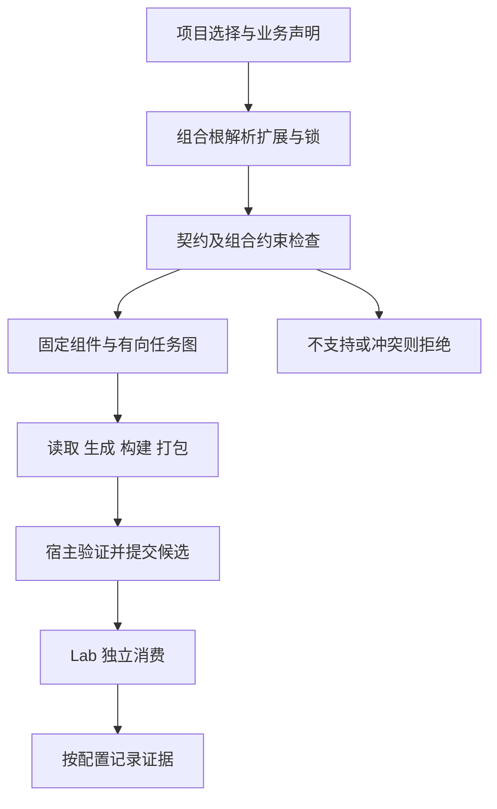

# MadB 跨路线扩展组合与接入契约

设计基线：0.9。状态：架构与需求设计采用，运行实现和认证分别验收。决定见 [ADR-0012](../adr/0012-extension-composition-and-delivery.md)。本规范适用于全部主线路线及后续语言、运行时、后端、SDK 体验、工程和交付扩展。

[扩展规范](11-language-extension.md)负责身份、包与公开端口；[进程协议](12-extension-protocol.md)负责控制会话；[模型演进](13-contract-evolution.md)负责公共语义。本页规定这些能力如何组合为一个确定的 SDK 配置，不增加平行核心、万能插件基类或第二套构建器。

## 1 设计边界与实施决定

架构入口、责任、组合约束和验收要求可以先确定；候选名称或结构检查本身不代表实施授权。本轮项目所有者已授权 [ADR-0015](../adr/0015-swift-extension-delivery.md)所选 Swift 需求，以及 [ADR-0016](../adr/0016-arkts-production-baseline.md)、[ADR-0017](../adr/0017-arkts-extension-delivery.md)所列 ArkTS 必要与扩展范围的文档、计划和实现推进，并委托实施负责人安排子范围顺序，无需逐项重新申请开工。需求驱动的候选仍按各项选择条件启用，授权不表示所有工具默认进入工程或所有任务已经开工。

E01–E06 是主线扩展机制；I/L 中按配置启用的能力保留原有产品归属；X01–X09、I07、L08 保留各自范围。技术依赖和必需证据约束验收，不自动决定开工日期。已授权任务按既有范围继续，C07 不因本页追加其他路线的功能。项目所有者选择延期某项能力时，相关完成承诺保持缺失；不能把延期写成通过，也不自动删除主线范围。

三个事实分别表达：设计规定什么、实现能做什么、哪个固定候选已经通过。项目所有者的启动决定沿现有任务或 PR 记录，状态只在 implementation-plan.json 维护，不建立另一套排期或批准字段。

## 2 扩展点与责任

| 扩展点 | 接入位置 | 输入与输出 | 固定边界 |
|---|---|---|---|
| 声明与元数据来源 | ContractReader / helpers | 实际编译器或后端元数据 → ContractSnapshot 与来源 | 不从类型名猜所有权、线程或取消；未知声明准确拒绝 |
| 绑定后端 | Generator / adapters | 受检 ContractIR、profile、锁 → 绑定源码与 OutputSet | 复用上游生成器；不把多段互调自动认证为直连 |
| 惯用 API 与模型投影 | generators + sdk | 普通边界 API、明确策略 → 必要 Facade、快照或错误映射 | 按声明生成变化部分；通用运行时集中维护；不强制复制所有模型 |
| SDK 运行时能力 | sdk 的语言/能力模块 | 操作、订阅、资源及执行器协议 | 采用适用语言原语；不依赖工具核心、不创建隐式业务全局 owner |
| UI 与响应式消费 | 独立 SDK 集成模块 / 对应 L 或 X 任务 | 普通公开 API → 框架适配 | 显式启用、声明生命周期；无 UI 配置不引入 UI 依赖 |
| 宏、注解处理与语法便利层 | helpers / generators / sdk | 源声明或普通 API → 元数据、新声明或薄调用入口 | 作者侧处理与消费侧语法分开；不能绕过边界规则 |
| 工具链与原生构建 | Toolchain + templates 的构建入口 | 冻结任务与工具输入 → BuildEvidence | 复用 TaskGraph、Wrapper 与输入追踪；不建立递归应用构建 |
| 工程模板 | templates/projects、modules | 模板选择与 ProjectPlan → 新工程及受管构建接线 | 纯模板不伪造扩展组件；用户文件不被后续生成覆盖 |
| 制品装配与渠道格式 | ArtifactPackager | 固定 Source/Build 及公开资产 → Candidate | 打包方无最终提交和发布权；同一版本内容一致 |
| 验证与诊断 | Verifier / Lab / diagnostics | 固定候选与独立用例 → 观察、报告和可选指标 | 验证者不能自授认证；关闭诊断不关闭资源保护 |
| 远程存储、IDE 向导等宿主服务 | 既有宿主端口；X09、I07 等 | 各服务的显式请求、权限和结果 | 不借 package 或元数据执行；新进程操作先做协议版本演进 |

这是责任划分，不要求每种责任都新建一个包。一个扩展可以复用现有 Reader、Toolchain 或 Packager，只贡献缺失部分。同一工具的构建端组件与 SDK 运行依赖可以属于不同交付单元，必须分别声明。

## 3 从选择到交付

1. 只解析项目明确选择的路线、profile、模板和增强项。安装顺序、全局 PATH 和机器上碰巧存在的库不能决定选型。
2. 组合根核对包身份、组件引用、依赖图、协议/IR 版本及执行权限。解析可以选择已声明的兼容版本；frozen 执行只接受锁中的精确组合。
3. 从真实业务声明提取结构，结合显式策略形成接口需求。组件自报能力只用于候选匹配，不构成支持证明。
4. 规则检查实际需求、组件能力、平台约束及机制责任。没有合法组合时报告冲突双方、来源和受影响符号，不自动换桥或削弱接口。
5. 生成已解析组合计划，固定每个任务的组件、输入、输出域、依赖和预算，再由现有应用用例执行。
6. 每个生成步骤先核对其独立 OutputSet。组合输出只有全部必需步骤有效、文件所有权无冲突后，才能按既有 Source 事务提交；随后 Build/Candidate 保持原有父批次血缘。
7. Lab 从候选公开入口消费；推荐或发布前必须具有该组合的必需结果。实验组合可以留下实现观察，但不继承基础 profile 的认证。

复用组件代码和复用某次执行结果是两回事。只有输入、版本、语义、配置及依赖身份满足缓存规则时才能复用执行结果；缓存命中不生成新的消费者证据。

### 首版组合的复杂度边界

优先交付有限、显式维护的推荐 profile 及允许组合，精确锁定其依赖和机制责任；实验配置显示具体缺口。无需先实现任意第三方库、任意版本和任意能力的全局求解器，才能交付一个可用配置。现行锁之外的选择通过明确更新流程解析，frozen 执行不重新选型。

增加 UI 集成通常只涉及 SDK 模块、配方和消费用例；替换后端涉及适配器、profile 和受影响验证；只有新的共同语义才演进 IR。依赖包管理器已有的冲突与版本机制可以复用，但不能替代 MadB 的阶段责任、ABI、资源和候选检查。公开端口与协议支持复用，扩展不需要重建整条工具链。

## 4 组合计划的逻辑契约与格式归属

下面定义必须表达的信息，不是可直接粘贴进现行 v1 JSON 的新字段。对外字段仍只由 docs/schemas 及共同格式向量维护；实现阶段不能按本文表格另写一套私有 wire。

| 必需信息 | 语义 | 现有归属或演进要求 |
|---|---|---|
| 选择与目标 | 扩展/组件身份、基础路线、方向、具体目标及启用项 | 清单 routes/bindings、profile、项目选择；不得推导目标笛卡尔积 |
| 能力与前提 | requires/provides、支持子集、必需前提及明确冲突 | required_features、能力限制、版本化适配器配置；跨组件公共语义按 E03 演进 |
| 精确依赖 | 来源、版本、摘要、作用域、目标、装配责任 | lock/tools/components/inputs；SDK 依赖进入候选清单，构建依赖进入任务输入 |
| 机制分工 | 符号、语义阶段、边界/实例作用域和唯一责任方 | DEC-07；由已解析配置产生受检责任表 |
| 处理步骤 | 端口操作、组件绑定、顺序、输入输出格式与文件 owner | 现有请求/结果、TaskGraph 与 Source/Build/Candidate 事务 |
| SDK 暴露面 | 普通 API、必要适配、增强模块、公开依赖及资源协议 | ContractIR、SDK 配方、ProjectPlan 与候选公开清单 |
| 故障与预算 | 超时/取消、项数/字节、失败阶段、清理和回滚责任 | 现有生命周期、进程和预算规范；按实例明确数值与执行位置 |
| 验证适用性 | 支持项、拒绝项、组合新增风险及独立消费者 | 既有 Case/Report、EXT、CRIT、INIT、DX；不由扩展自报通过 |

当前 extension-manifest v1 的 dependencies 只登记逻辑身份和类别，restrictions 是说明文本，不能承担完整版本求解或可执行冲突判断。独立适配器的私有、受检配置可以通过 profile.backend_config 的 FileRef 接入；该配置必须有明确版本、schema、读取方、摘要和未知键拒绝。跨组件共同理解的选择、冲突或责任字段，必须先在 E01/E03 明确其规范归属和版本，再通过共同格式向量集成，不能藏进可忽略的 extensions 元数据。

只认识旧版本的工具必须拒绝新的必需组合语义。若现有字段已经充分表达，则直接复用，避免仅因换库而增加 feature；确有缺口时按模型演进规范增加必需功能或新格式版本。设计样例通过结构检查不表示现行 CLI 已接受这些组合。

组合计划是 app/plan 所需的受检值，不是可被全局查询的插件服务定位器。Registry 只在组合根可见；纯规则接收确定的能力、身份和约束，不访问磁盘、启动进程或导入后端。

[ADR-0018](../adr/0018-extension-composition-formats.md)已采用具体 composition/1 与 profile/2 输入格式；字段以[公共 schema](../schemas/README.md)为准。格式结构、纯输入检查与组合执行分别准入，现有 v1 路径不自动接受新版本。设计提案的样例通过不能替代生产清单、生成后资产和独立消费。

## 5 允许的组合方式与冲突规则

| 方式 | 例子 | 准入要求 |
|---|---|---|
| 替代实现 | 同一接口选择不同协程桥或互操作后端 | 单次选择一个明确责任方；变成独立 profile，重新验证受影响保证 |
| 分阶段协作 | 后端负责 ABI，后续生成器提供普通 API | 明确中间表示、顺序、来源和输出 owner；前阶段结果冻结后交给后阶段 |
| 外层增强 | 普通 API 上增加 UI 或响应式入口 | 复用普通 API 与既有协议；独立声明新增订阅/调度和生命周期 |
| 独立并列能力 | 文档生成与独立诊断资产 | 输出域不冲突；不影响 SDK 安全结论；可单独关闭 |
| 多段桥接 | 一个公开 C ABI 再由另一语言消费 | 定义每段表示、复制、错误、保活和停止语义；组合独立验证 |

每个适用的“边界 + 规范符号/操作 + 语义阶段 + 实例作用域”必须有一个权威责任方。类型读取、ABI lowering、模型投影、异步桥接、源订阅、执行器投递、取消、停止、排水、最终释放和物理库装配分别分工，不能用一个含糊的“该插件全包”替代。

这一约束不禁止业务主动创建多个订阅。禁止的是同一逻辑订阅被两个生成器或便利层重复注册；共享流、广播与多观察者必须各自声明源订阅数、缓存、重放和 owner。

以下情形在执行或候选提交前拒绝，不能依赖安装顺序解决：

- 同一阶段两个组件争夺责任，或必需阶段无人负责。
- 多个生成器写同一路径、导出冲突符号，或后阶段就地修改已冻结输出。
- 依赖版本、ABI、最低系统、构建模式、运行时或可用线程条件没有共同解。
- 两个模块各自打包同一个必须唯一装配的原生内核，或重复初始化同一注册器。
- 所选增强层要求底层不存在的取消、跨线程值语义、零拷贝或同步返回能力。
- 多组件构建出现循环，或模板使 Gradle/Xcode/Hvigor 再次递归构建调用它的同一应用。

确实需要共享一个文件或符号空间时，由一个明确的生成/装配节点接收上游中间产物并统一输出；其他节点不并发追加或覆盖该文件。

## 6 依赖作用域与 SDK 装配

| 作用域 | 典型内容 | 消费与分发规则 |
|---|---|---|
| 工具宿主 | 编译器、生成器、源码解析器、格式工具 | 仅生成/构建阶段需要；固定宿主和工具身份 |
| 作者构建插件 | KSP、Gradle 插件、编译器插件 | 安装到正确生产者构建；不能只在消费应用加包 |
| 消费端编译 | Swift 适配源码、公共头、模块描述 | 明确最低工具链、公开依赖及导入传播 |
| 目标运行时 | 原生库、协程桥运行库、必要 SDK 原语 | 固定目标/ABI/装载与释放责任；进入候选闭包 |
| 可选集成 | UI、响应式、宏便利层 | 仅被明确选择的模块引入；禁用后普通 API 可独立消费 |
| 验证与开发 | 测试工具、诊断辅助、示例应用 | 与生产包区分；测试导出不进入普通 Release 候选 |

一个依赖可承担多个作用域，但每种实际用途都要记录。包名相同不证明宿主工具与目标运行库版本一致，也不证明二进制兼容。

Swift 不按能力条目机械拆包。基础公开接口不泄露未选择的 Rx、UI 或自定义宏依赖；增强模块复用同一 native 制品，作者侧生成工具不进入消费者运行闭包。SwiftPM 的 `platforms` 是包级最低系统声明，拆 target 不等于分别降低要求；先评估 availability 隔离，确有最低系统、依赖解析或发布冲突时再拆包。独立消费者检查未选配置是否仍触发额外解析、下载、编译、链接或最低系统抬升，不能只凭模块图宣称无成本。

相同原生实现经过多个绑定进入同一应用时，物理库、符号和业务 owner 按 DEC-09 有唯一装配责任。共享源码不等于共享实例；独立实例必须明确其 route/profile/env，组合共享实例必须只有一个 owner。官方 Kotlin 与 CPF 等互不兼容的工具链根、缓存和发布元数据按既定规则隔离。

公开源码集成和二进制分发分别建立 profile。新增扩展如果改变 SDK 公共依赖、模块导入、库装载或最低系统，应进入候选身份并执行消费验证，不能只记录为内部构建工具更新。

## 7 运行与故障的两层生命周期

构建扩展生命周期采用现有 hello/invoke/result/cancel 状态机。每个真实组件独立校验身份、输入和结果，组合根协调顺序；一个组件不能凭已握手会话调用其他组件。当前控制操作仍只有 read/generate/build/verify/package。

组合取消必须先关闭最终提交准入，再停止派生工作并完成输出收尾。某一必需节点失败时，不提交部分 Source 或 Candidate；保留旧完整批次和可定位诊断。已有成功节点的隔离工件只有满足重放与身份条件时才能用于后续重试。

SDK 的资源和订阅生命周期由实际运行时协议定义，与构建进程的退出分开。扩展必须说明：

- 谁启动底层工作，谁创建源订阅、观察器、执行器和结果容器。
- Task/协程/Promise/订阅取消对应停止等待、停止观察还是停止生产。
- 关闭后如何阻断新入口，如何清理迟到结果及等待已准入回调排空。
- owner 或 env 先退出时，哪些清理仍合法、在哪个线程执行。
- 哪个 ACK 证明哪项责任完成；没有完整证明时保留缺口。

UI 适配持有的观察任务与原生资源应有确定作用域；属性 getter、宏展开和状态读取不能隐式注册无法释放的订阅。必要的容量、线程与资源保护不受日志、追踪开关控制。

## 8 跨路线需求与接入样例

本表冻结需求类型与接入责任。工具名沿用现有选型文档或作为候选示例，不表示选定了新版本、已实现或已兼容；实施授权按第 1 节执行。每项实际需求复用原工作包；无需为了本表新增任务。

| 路线或扩展 | 可以确定的需求 | 接入与组合约束 | 既有归属 |
|---|---|---|---|
| Kotlin→Swift 普通 API | async、流、错误及资源的惯用入口；受支持声明可重新生成 | 优先复用 SKIE；手写通用原语与按声明生成的 Facade 分开 | C06、L01/L03/L04、I04 |
| Swift 响应式消费 | Combine/Rx 正式可选入口 | 普通 Swift 适配可跨后端复用；Kotlin 选定配置采用 NC，逐接口关闭重叠协程桥并保留 SKIE 类型增强 | L04 普通适配；X01 Kotlin 组合 |
| Swift UI/语法增强 | Observation、选用薄宏或属性封装器 | 普通 API 独立可用；明确最低系统、actor/执行器和观察生命周期 | L04、I04 |
| Apple 构建与分发 | 普通 IDE 构建可更新生成物；选定 SwiftPM/XCFramework 交付 | SwiftSyntax、SwiftPM 插件或 KMMBridge 只按实际职责选用；不重复管理锁和候选 | I01/I04、L04、C10 |
| Swift↔C/C++ | 所选对象/错误/回调子集及公开包消费 | direct-source 与 C/ObjC++ 包装分 profile；方向、C++模式和依赖传播独立验证 | C08、L06、I06 |
| Rust↔Kotlin/Swift | 复用实际导出声明、值/资源/async 与目标绑定 | UniFFI/Gobley 的生成器、scaffolding、runtime 和修补必须成套锁定 | C06、L03/L04、C10 |
| Kotlin UI 与作者插件 | 协程流、Compose 适配、受限声明处理 | 冷/热源和共享 owner 明确；KSP 为构建组件，UI 依赖按配置交付 | L03、I04/I05 |
| ArkTS 主线与体验 | Promise、状态/事件、ArkUI 生命周期、HAR 消费 | 复用 C07 既定前端/协议；env/线程、关闭与完成责任不能由包装外观替代 | C07、L05、I05 |
| ArkTS 替代后端 | ANI、KNOI、UniFFI ArkTS 各自的明确子集 | 独立 profile、来源和验证；不隐式串接到主线或继承其证据 | X03、X07、X08 |
| JVM 原生接入 | JNI 或明确的 FFM/JNA 扩展配置 | 目标 JDK、Android适用性、装载与异常各自声明，不隐式替换 | C08、X04 |
| Rust/C/C++ 原生扩展 | 已声明 ABI、对象和回调子集；可选择新的绑定实现 | CXX/Crubit 等按真实机制验证；分配/释放、异常、标准库与符号装配不省略 | C05/C08、L02/L06、X05 |
| 新语言探针 | 一种新消费语言复用现有公共契约 | 首例 Dart Native→C 同步子集；公开端口、禁用隔离、真实消费 | E04/E05；正式新范围 X06 |
| 远程制品或 IDE 向导 | 固定候选的存取或复用现有初始化体验 | 权限、取消和副作用独立；新增控制操作先演进协议 | X09、I07 |
| 深度诊断或编译器插件 | 明确的诊断/生成需求与开销上限 | 诊断关闭后安全保证不变；改变公开语义时重新评审契约 | L08 |

### Swift 组合的具体责任示例

Swift 的十二项必要能力、后端取舍及既有任务映射见 [ADR-0014](../adr/0014-swift-production-baseline.md)，九项扩展选择及完整交付出口见 [ADR-0015](../adr/0015-swift-extension-delivery.md)；普通 API 与真实业务生成由[语言体验规范](15-developer-ergonomics.md)维护，本节只规定组件如何分责。

一个 Kotlin→Swift 配置可由“SKIE 类型/协程桥 + 必要 MadB Facade + 可选 UI 模块 + Apple 打包配方”组成。SKIE 已提供的能力由后端负责；Facade 按声明补齐必要业务入口、快照、执行器或停止接线；UI 模块消费普通 API；打包节点交付二进制与适配源码及其一致身份。通用运行原语可以手写，随业务变化的 Facade 不能靠复制固定样例维护。

Rust→Swift 的 UniFFI 绑定/运行库、Swift→C 的 Clang 导入面与 Swift/C++ 包装分别承担各自的表示和调用责任，不为统一 Swift 外观而叠加 SKIE 或第二套 ABI 检查。SwiftPM 包装负责声明公开模块、二进制与源码依赖，不能替代后端生成、资源协议或候选发布门禁；SwiftSyntax、SwiftPM 插件或 KMMBridge 只有在对应配置明确需要时才成为组件或工具依赖。

选定 Kotlin 响应式配置使用 NativeCoroutines 时，对相应接口关闭重叠协程生成，再验证 Kotlin 插件、Swift 运行库、命名、取消及释放。该选择不将所有 Combine/Rx 消费绑定到 NC，也不替换其他 Kotlin 接口的主线 SKIE 责任。原生资源仍经普通协议接线，不能通过直接暴露另一套 Publisher 绕过停止与排水。

L04 的普通 API、基础 UI 和其明确选择的通用响应式适配不等待 X01。X01 保留 C11 验收前置，之后复用 C09/C10/L07 已建立的工具和案例，为新候选取得扩展证据；不得反向成为 L04/L07/C11 的整体验收前置。X02、L08 同样按各自任务前置单独验收，复用验证能力不等于重建任务依赖环。

这些模块可来自不同包，但最终不是把所有库相加：冲突检查必须先产生一个确定组合。任何尚未证明的最低系统、Sendable 或跨 actor 保证都不得由生成的注解宣称成立。

### ArkTS 组合的具体责任

ArkTS 的十二项必要能力以 [ADR-0016](../adr/0016-arkts-production-baseline.md)为唯一详表，十二项扩展的选择、替代方案与交接以 [ADR-0017](../adr/0017-arkts-extension-delivery.md)为唯一详表。C07 负责既定互操作与 native 协议，L05 负责普通 API 体验及 ArkUI 薄适配，I05 负责工程消费体验；替代后端继续归属各自 X 工作包，不增加平行协议 owner。

L05 页面状态首片可与 C07 并行推进，先通过已有普通观察接口对接注册、停止与排水，不改变 C07 的 Runtime/Engine/Operation/Subscription 语义。UI 组件、响应式适配和语法便利层消费普通 API；它们各自通过不授予 native 路线、完整 SDK 或发布候选认证。CMP 仅由共享 UI 需求选择，ArkTS UI 消费纯 Kotlin 逻辑不因此引入 Compose。

### 其他路线的同等规则

Kotlin/ArkTS 选择 KNOI 时形成独立配置，不能把它当作 akinterop 后面额外接一层。Rust/ArkTS 改用 UniFFI ArkTS 时重新检查实际前端、目标库、环境清理及依赖闭包。Swift/C++ 源码共同构建成功不授予二进制 SDK 分发能力。

同一个 C ABI 可被多个消费者适配器复用，但每个消费者的整数、字符串、资源和线程映射都要真实验证。该复用降低适配工作量，不产生任意语言之间的传递支持关系。

## 9 新业务声明、生成与工程可持续使用

扩展后端与扩展业务声明分别验收。新后端只跑通固定示例，不等于已有后端已经接受任意新业务接口。每个 profile 明确可接受的声明子集、必要策略和拒绝形态。

在声明子集内，独立业务模块新增方法、模型字段或受支持资源时，应通过正常输入与声明配置完成生成，无需修改 MadB 私有源码或生成文件。若提出新的公共语义，先走模型演进，不能扩大允许清单冒充已支持。

生成器复用真实声明，产生实际需要的绑定与薄适配；通用运行时继续手写维护。原始 API 与便利 API 的公开关系、文件 owner 和来源位置明确，不能把固定示例的复制源码当作业务代码生成证明。

IDE 与 CLI 调用相同的 Wrapper/任务入口，变化追踪覆盖新增导出、新生成文件、间接头、宏和依赖；一次构建固定同一批次。增加或删除扩展涉及用户模块/文件时，先给出可审查的变更范围，沿已有初始化或工程更新能力执行；不能用重复 init 覆盖已有工程。

## 10 验收、升级与禁用

| 验证面 | 必需正例 | 必需负例或隔离证明 |
|---|---|---|
| 注册与选择 | 独立包解析、精确锁、有效组件引用 | 重名、依赖环、错误端口、无兼容版本、未知必需语义拒绝 |
| 组合责任 | 各阶段有唯一 owner，合法分阶段组合可执行 | 重叠桥接、重复订阅、输出冲突及缺失阶段拒绝 |
| 依赖与装配 | 构建/运行/可选依赖闭合，目标与物理装配一致 | 错 ABI、缺库、重复内核、错误初始化次序拒绝 |
| 生成与工程 | 第二个独立业务模块可重生成、IDE 增量构建可消费 | 不支持声明定位准确，失败不覆盖旧批次及手写文件 |
| 生命周期 | 启动、取消、停止、排水和关闭符合声明 | 迟到完成、回调重入、满载、owner/env 提前退出 |
| 包与独立消费 | 从公开候选安装并执行所选配置 | 生产者私有路径、手工补库、混版本与候选身份不符拒绝 |
| 升级与禁用 | 显式更新锁、新版本重新验证、禁用后基础配置可消费 | 旧锁不被改写、其他路线不受污染、孤立运行依赖不残留 |

“禁用”表示下一次构建和交付选择，不承诺运行中的动态卸载。存在活跃 SDK 实例时，仍须遵循其关闭协议；插件进程退出或库文件被删除不能当作资源释放。

升级先生成明确的选择/锁/输出变化；失败保留旧锁和旧完整批次。降级也重新检查兼容，不把版本号较小视为自动安全。新增工具链、生成规则、运行时或必要适配使相关证据失效；无法证明影响范围时按现有规则保守处理。

验证覆盖基础配置、每个承诺可选项、每种被允许的组合和相关冲突。日常回归可以根据声明、依赖和运行时变化的可证明影响范围选择；无法证明范围时保守扩大。推荐与发布前仍核对全部承诺项的有效证据，不以“未改文件”或缓存命中补出通过结果。

不能仅凭两两通过推导任意组合可用；无语义相互作用的维度才可用有依据的抽样缩减测试，关键所有权与取消交错必须显式覆盖。矩阵先限定支持承诺，再优化执行成本，不把缩减测试伪装成扩展支持。

验收继续使用 EXT-01 至 EXT-12、CRIT、INIT、DX 和已有 Case/Report，不再创建另一套编号或证据平台。E04/E05 要证明另一位开发者可通过公开契约交付独立扩展、禁用它不影响基础路线；E06 再完善作者交付体验。

## 11 每项扩展启动时需要确定的需求

以下信息直接写入对应任务、设计或 PR，引用已有规范即可，不要求每项重复一套长文档：

1. 用户场景、普通 API、增强后的可见行为及明确不承诺范围。
2. 基础路线、方向、目标、分发方式和支持声明子集。
3. 复用组件、必要新增部分、替代或叠加关系及每阶段责任。
4. 构建与运行依赖、候选版本范围、冲突、来源和精确锁的冻结方法。
5. 资源、线程、取消、停止、排水、预算和失败处置。
6. 生成与手写分工、公开包内容、IDE 变化和来源诊断。
7. 独立消费者、正反用例、升级/禁用及受影响旧路线回归。
8. 按第 1 节的既有授权记录实际实施子范围，状态和证据回到既有任务目录；已授权范围无需逐项重新申请启动。
